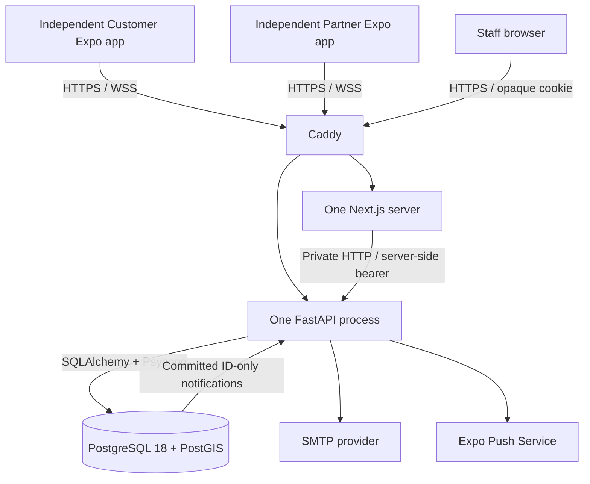

# Current architecture

Updated 4 November 2026. This describes implemented software. The dated [foundation handbook](FOUNDATION_HANDBOOK.md) explains the earlier architecture milestone.

## Components

Caddy is the public entry in the production configuration. The local development stack publishes loopback API/database/mail ports and runs the apps separately. Local SMTP uses Mailpit. Local tests simulate Expo delivery; no real provider success is implied.

| Component | Owns | Does not own |
|---|---|---|
| Customer | Forms, meeting-point choice, coarse discovery, visits, authorized tracking, account and preferences | Authorization, approval or database credentials |
| Partner | Business/review screens, explicit sharing, location adapters, incoming visits and external navigation | Self-approval or arbitrary workflow transitions |
| Shared packages | Strict data contracts, HTTP/session coordination, realtime transport and design tokens | Screens or product authority |
| Next dashboard | Staff UI and bounded server-held API sessions; opaque browser cookie | Final authorization or direct database access |
| FastAPI modules | Live actor checks, privacy, transactions, workflow, queries and jobs | Guaranteed physical GPS or notification delivery |
| PostgreSQL/PostGIS | Durable rows, spatial indexes, constraints, locking, outbox and commit hints | Trusting a client-supplied role or phone GPS |

## One request and one transaction

A route validates input, resolves the authenticated actor and opens a SQLAlchemy session. The service reads/locks the necessary rows, enforces role/ownership/current state, changes the model and commits its event/outbox changes together. Failure rolls back. Psycopg carries parameterized SQL over the database connection. The session closes after the request; its connection returns to the engine pool.

Inside Compose, `db:5432` is the database service. Python on Windows uses `127.0.0.1` and the published development port. `localhost` inside an API container means that API container, so it cannot identify PostgreSQL. No mobile screen connects to PostgreSQL.

## Module boundaries

`app/main.py` assembles routes, middleware, listener and maintenance lifespan. `config.py` validates configuration; `database.py` owns the engine/session factory. Feature folders own their routers, schemas and services. Models describe current tables; explicit Alembic migrations introduce them.

Authentication locks the account before refresh-family changes. Sharing writes lock account, then vendor, then location. Visit changes serialize on a visit/version and atomically append events. Cleanup uses separate transactions where combining locks would reverse writer order. See [DATABASE.md](DATABASE.md) and source comments for these decisions.

## Live data and delivery

Discovery returns a coarse grid point and kilometre band. Exact vendor coordinates require a current accepted/approaching/arrived visit and live participant checks. Offline, suspension, terminal states and stale fixes stop disclosure. Abandoned fixes older than 90 seconds are physically removed by bounded maintenance; no route-history table exists.

WebSocket authentication uses an initial message, with no tokens in URLs. Bounded queues carry identifiers. The sender resolves current state and rechecks authorization before transmission. PostgreSQL notifications become visible after commit. Reconnect/resume uses REST to reconstruct current state.

Events enqueue durable per-device notification jobs in the business transaction. The dispatcher claims a bounded lease, performs network I/O outside the transaction, then records guarded tickets/receipts. Generic payloads contain identifiers; opening an alert still requires authorized REST. Retries can produce duplicate operating-system alerts.

## Deployment constraints

One API process owns connection queues and transient arrival candidates. One Node process owns up to 256 staff sessions in memory for eight hours; restarting it requires sign-in. Replicas require shared-state coordination first. Caddy and Node have reserved trusted proxy addresses; the database is on an internal network. See [PRODUCTION.md](PRODUCTION.md).

Native apps have distinct IDs, session keys and EAS profiles. Native SecureStore holds the token pair; browser mobile previews hold it only in memory. Partner headless callbacks never rotate credentials, so background-only sharing is bounded by the access token's remaining lifetime. Permission, OS scheduling and device delivery need physical evidence.
