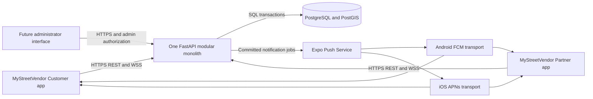
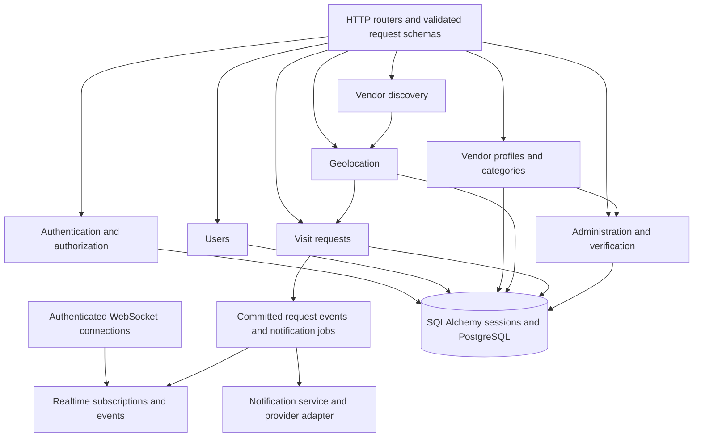
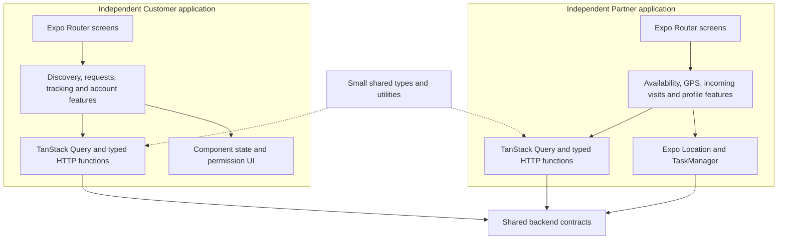
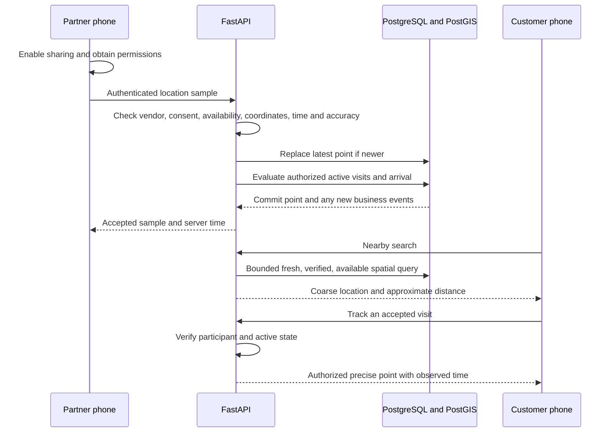
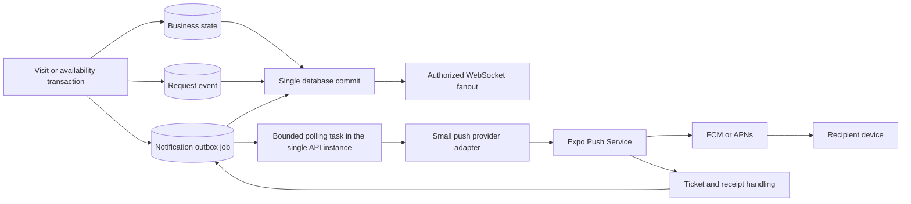
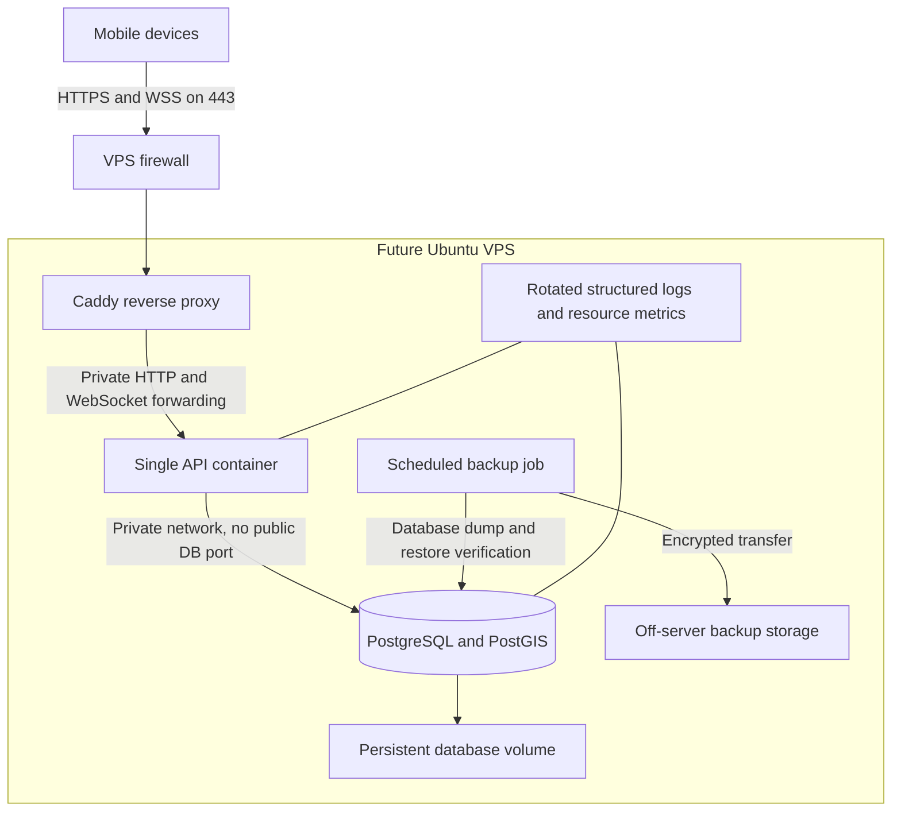

# MyStreetVendor architecture

Status: Phase 0 design, 21 October 2026. Phase 1 implements only the backend foundation. Every authentication, vendor, location, request, realtime, notification, mobile, administration, and production feature described below is **planned** until its roadmap phase is implemented and verified.

## 1. System boundaries

MyStreetVendor connects nearby customers with mobile street vendors. Two independent mobile applications use one FastAPI backend. PostgreSQL is the authority for accounts, vendor availability, visits, and committed events. A completed visit does not prove a purchase occurred; payments, orders, and sales accounting are outside the initial MVP.



Phones never receive database credentials or connect directly to PostgreSQL. GPS readings, status selections, and push tokens are untrusted input. The server checks identity, ownership, permissions, and allowed state changes before committing anything.

## 2. Technology decisions

| Area | Decision | Reason |
|---|---|---|
| Backend foundation | Python 3.13, FastAPI, Pydantic 2 and Pydantic Settings | Explicit types, validated input and configuration, generated OpenAPI documentation |
| Database access | SQLAlchemy 2 with synchronous Psycopg 3 | Straightforward transactions and debugging for the initial workload |
| Schema changes | Alembic migrations run explicitly | A reviewed and reproducible history of database changes |
| Storage | PostgreSQL 18 with PostGIS 3.6 | Relational integrity and spatial search in metres |
| Development | Docker Desktop Linux containers and Docker Compose, driven from PowerShell | Consistent services while developing on Windows |
| Mobile, planned | Two Expo/React Native apps, strict TypeScript and Expo Router | Independent users, permissions, navigation, and releases |
| Server state, planned | TanStack Query | Request cancellation, caching, refetching, loading and error states |
| Forms, planned | React Hook Form and Zod where forms justify them | Understandable validation without a custom form framework |
| Production, planned | Ubuntu VPS, Compose, Caddy, HTTPS/WSS | Small operational footprint under the project owner's control |
| Notifications, planned | Backend adapter calling Expo Push Service | Replaceable transport without changing visit rules |

Use normal `def` HTTP handlers for synchronous database work. Future WebSocket handlers use `async def`; they must offload synchronous database work to a thread or call a deliberately asynchronous data path. A blocking database call directly inside an async handler would stall other work on its event loop. See [FastAPI's execution guidance](https://fastapi.tiangolo.com/async/).

The exact Python dependencies are pinned by the implementation. Mobile dependency versions will be selected together from the current supported Expo SDK when Phases 8 and 9 begin; no mobile dependency manifest exists in Phase 1. The [PostGIS image repository](https://github.com/postgis/docker-postgis) documents the `18-3.6` image and its PostgreSQL 18 volume path.

There is no microservice split, Kafka, Kubernetes, Redis, background-worker service, or replica database in the foundation. Separate processes are introduced only when measurements justify their operational cost.

## 3. Backend module architecture

The backend is a modular monolith: one deployable application with clear ownership of business rules. Modules are added when their phases start. Phase 1 needs configuration, a database session dependency, a health handler, migrations, and tests; it does not need empty implementations of every future module.



| Module | Owns | Must not do |
|---|---|---|
| Authentication | Password verification, access tokens, refresh rotation, session revocation, server-issued roles | Accept an admin role from a registration payload |
| Users | Account details, suspension and deletion workflow | Return credentials or session secrets |
| Vendor profiles | Public business profile and availability | Treat an online toggle as verification approval |
| Product categories | Controlled categories and vendor associations | Duplicate category strings throughout unrelated records |
| Discovery | Bounded nearby searches and public summaries | Expose precise private location points |
| Geolocation | Validated latest points, freshness and consent checks | Trust phone timestamps or continuous delivery |
| Visit requests | State transitions, participants, expiry and transaction boundaries | Depend on a push provider to commit a request |
| Realtime | Authorized subscriptions, bounded connections and reconnect behavior | Act as the durable source of request status |
| Notifications | Durable jobs, attempts, receipts, token cleanup and provider adapter | Promise guaranteed delivery or exactly-once display |
| Admin and verification | Restricted verification decisions, suspension and audit trail | Allow vendors to verify themselves |

Start a feature with a router, validated schemas, and a small service containing its transaction. Add models to that feature when needed. Avoid generic repository classes, a custom dependency injection framework, and duplicated pass-through layers. Shared configuration and session management remain shared because every feature needs them.

One HTTP request receives one SQLAlchemy session. A service owns the transaction for a state change; it commits the state, audit event, and future notification job together. Do not commit halfway through a multi-step operation. Never reuse a mutable session across concurrent requests or hold it for the lifetime of a WebSocket connection.

## 4. Independent mobile applications, planned



The apps have separate Expo configurations, display names, Android application IDs, iOS bundle IDs, permissions, navigation, build profiles, signing and release tracks. Final identifiers require a domain controlled by the project owner; sample identifiers are not production registrations. Neither app contains a customer/vendor role switch.

Each app will contain `app/` for route entries, `src/features/` for feature code, and small `components/`, `services/`, `hooks/`, `utils/`, `types/`, and `assets/` directories as needed. Route files delegate meaningful work to feature components. Share API types and genuinely identical utilities; keep screens and business experiences independent. Add a root JavaScript workspace only when the first mobile app is introduced.

The customer journey is permission/selected meeting point → nearby map or list → vendor details → request → request status → authorized tracking → history. Provide filtering, approximate distance, cancellation, and accessible loading, empty, denied-permission, stale-location, and error states. A selected meeting point must work without forcing the customer to reveal a home address.

The partner journey is verification/profile → clear online/offline control → incoming requests → accepted meeting points → visit progress → history and simple daily counts. Use large controls, readable Tamil and English labels, a persistent sharing indicator, and an obvious way to stop sharing. A connected socket is distinct from an online vendor with a fresh GPS point.

| State kind | Example | Owner |
|---|---|---|
| Component state | Whether a filter panel is expanded | React hooks in that screen |
| Application state | Selected language and current signed-in identity | Small shared context/store only if necessary |
| Server state | Vendor results and request status | Backend authority; cached by TanStack Query |
| Persistent device storage | Refresh token or language preference | SecureStore for sensitive tokens; suitable preference storage for nonsecrets |
| Database state | Request accepted and its participants | PostgreSQL through trusted backend transactions |

Use a central API base URL per development/staging/production build. Ship no backend secrets in app configuration. Keep access tokens in memory where practical and refresh tokens in SecureStore; coordinate concurrent refresh attempts. After reconnect or app resume, refetch authoritative request status before resubscribing. Cancel obsolete HTTP queries when the map location or screen changes. React Native DevTools, network inspection, and platform device logs will be added to the mobile debugging guide when runnable apps exist.

## 5. Location pipeline and privacy, planned



The database stores `geography(Point,4326)` values, with longitude first when constructing points. Spatial queries and distances use metres. The latest vendor row is separate from any later short-lived diagnostic history. Detailed routes are not collected by default.

Initial pilot defaults to validate, rather than hard platform promises:

- While moving, target a sample about every 15 seconds or 25 metres; while stationary, about every 60 seconds. Tune using battery, accuracy, network cost, and field measurements.
- Treat a latest sample older than 90 seconds as stale for discovery; show the observed time on an active visit instead of presenting a stale point as live.
- Reject invalid coordinate ranges, negative accuracy, samples more than 30 seconds in the future, overly old samples, and non-increasing sample timestamps. Treat accuracy worse than 100 metres as unsuitable for precise tracking or arrival detection.
- Use fresh, sufficiently accurate samples and repeated proximity evidence to propose arrival; the final radius and dwell interval need pilot tests. A GPS jump alone must not announce arrival.
- Stop discovery and precise broadcasts immediately when sharing is disabled, the vendor goes offline, verification is revoked, or authorization ends. Already-disclosed coordinates cannot be recalled; minimize retention and clear client caches.

Discovery uses a deterministic coarse area and coarse distance bands, with bounded radii and rate limits to reduce location triangulation. Exact current points are only available to participants after acceptance and while that visit remains active. Protect the customer meeting point as well. Public profile endpoints must not bypass these rules.

Expo background tracking requires platform permissions and native configuration, and relevant behavior must be tested in development builds. Android may require a foreground service and background permission; iOS requires its location background mode and appropriate authorization. Operating-system restrictions and app termination can stop updates, so the backend expires freshness instead of assuming continuous GPS. See [Expo Location](https://docs.expo.dev/versions/latest/sdk/location/).

| Condition | Expected behavior |
|---|---|
| Permission denied or revoked | Explain how to grant it; remain offline for sharing; allow a customer-selected point |
| GPS unavailable or poor accuracy | Show degraded status and withhold precise/arrival claims |
| Network failure or delayed GPS | Retry with bounded backoff; upload only still-useful latest data and preserve timestamps |
| Background suspension or battery optimization | Explain degraded tracking; server freshness removes stale discovery entries |
| Vendor offline | Stop sampling where appropriate, stop discovery and broadcasts, retain request state |
| Lost WebSocket | Show reconnecting, back off with jitter, then refetch state |
| App reopening | Recheck consent, permissions, session, availability and current request before resuming |

A Phase 4 mock GPS simulator will submit deterministic timestamped routes using the same authenticated endpoint. It must support stale, inaccurate, out-of-order, offline and network-loss cases without physically moving.

## 6. Visit lifecycle and concurrency, planned

```mermaid
sequenceDiagram
    participant C as Customer
    participant API as FastAPI
    participant DB as PostgreSQL
    participant V as Vendor
    C->>API: Create visit with idempotency key and meeting point
    API->>DB: Validate vendor and insert PENDING visit, event and job
    DB-->>API: Commit
    API-->>C: Created visit
    API-->>V: Realtime event or later push attempt
    V->>API: Accept visit
    API->>DB: Lock visit; check vendor and current state
    API->>DB: Commit ACCEPTED, event and job
    API-->>C: Accepted event; precise tracking now authorized
    V->>API: Fresh location samples and visit progress
    API->>DB: Evaluate approach/arrival and append transitions once
    API-->>C: Approach or arrival event
    V->>API: Complete visit
    API->>DB: Commit COMPLETED and revoke tracking eligibility
    API-->>C: Completion event
```

The allowed states and actors are specified in [API.md](API.md). Transactions enforce transitions; a phone cannot set arbitrary state. Lock the visit row or use a version-checked update, validate the current status, append one event, and commit. Return a conflict for an incompatible competing transition. Unique idempotency keys and one active request per customer/vendor pair prevent accidental duplicates. A vendor may have visits with several customers; the MVP does not reserve exclusive scheduling slots or promise an arrival time. Route ordering and capacity limits need separate approved product rules.

Pending requests expire according to a server timestamp, initially after five minutes. An accepted visit has a configurable active-visit deadline, initially 60 minutes. The backend checks deadlines on reads and commands, and a later periodic expiry sweep appends each expiry event transactionally. Cancellation and terminal states stop tracking. A disconnect alone does not complete or cancel a visit; freshness and the deadline/reconciliation policy handle it. Completion records the visit, with no inferred sale amount or purchase event. None of the expiry work runs in Phase 1.

## 7. Realtime and notifications, planned

REST performs durable commands. WebSockets deliver authorized live hints about already committed state. Push alerts devices when their apps may not be open. Local notifications are scheduled on a device; in-app messages are visible UI. None of those transports is the source of business truth.



Phase 7 adds the outbox table and an in-process polling task with a lease, bounded retries, and cancellation on shutdown. It uses short database sessions and runs blocking I/O off the event loop. Committed jobs survive process restart. A unique event/device/channel key prevents duplicate job creation while allowing delivery to each of a user's registered devices. Keep provider attempt identifiers and delivery outcomes, retire invalid tokens, and limit retries. A timeout after sending can still result in duplicate delivery; use stable notification IDs for client deduplication. Delivery is best effort, and a provider receipt does not prove a person saw the notification. [Expo's server delivery guide](https://docs.expo.dev/push-notifications/sending-notifications/) documents tickets, receipts and error handling.

One API process initially owns an in-memory WebSocket connection map. Authenticate a connection, authorize every subscription and event, bound message sizes and connection counts, and remove stale connections. Recheck access on logout, suspension, request termination and token expiry. Do not put reusable access tokens in URLs or logs. Reconnection uses backoff, REST state synchronization, and subscription renewal; missed GPS messages are replaced by the latest point rather than replaying a route.

Several API processes would otherwise have separate connection maps. Before increasing instance count, introduce an appropriate broker such as Redis pub/sub for cross-instance fanout and retain PostgreSQL for durable state. Pub/sub alone is not replay storage. Move outbox polling into a separate worker when job delay or API resource contention warrants it.

## 8. Local and future production deployment

Phase 1 runs `api` and `db` services on a Compose network. Inside the API container, `db:5432` resolves through Docker service discovery. From a Python process on Windows, use the loopback-published database port instead. `localhost` inside a container means that container, not the database service or Windows host. The named database volume persists across container replacement.

`/health` is a dependency-readiness check: it must perform a real query against PostgreSQL and PostGIS, returning `200` when they respond and `503` otherwise. Constructing an engine object is not a connection check. Database migrations run explicitly; API startup does not silently change the schema. A readiness check does not prove every future table, business feature, backup, or deployment is correct.



The production design adds TLS/WSS, a private database network, a restricted runtime database account, a separate migration account, resource limits, restart policies, rotated structured logs, monitoring, off-server backups and rehearsed restore/rollback procedures. It is not a production deployment in Phase 1. Read [DEPLOYMENT.md](DEPLOYMENT.md) before any later public deployment.

## 9. Repository evolution

Only the backend, infrastructure needed for Phase 1, and documentation are created now. The full intended layout is:

```text
MyStreetVendor/
  apps/                         # added in mobile/admin phases
    customer-app/               # independent Expo app
    vendor-app/                 # independent Expo app
    admin-dashboard/            # future Next.js interface
  packages/                     # added only when shared code exists
    shared-types/
    api-client/                 # only if justified
  backend/
    app/                        # current foundation; feature modules added later
    migrations/
    tests/
    Dockerfile
    pyproject.toml
  infrastructure/
    compose.yaml
    Caddyfile                   # future production phase
    scripts/                    # only when scripts solve repeated work
  docs/
  .env.example
  .gitignore
  README.md
```

Git checkpoints capture the documentation milestone and the verified foundation. Do not commit `.env`, database contents, tokens, logs containing private data, or local virtual environments. See the README for the actual current file inventory rather than assuming every planned path exists.

## 10. Risks, tradeoffs and review

| Risk or tradeoff | Design response | Evidence required later |
|---|---|---|
| Tracking leaks vendors' routes or customer homes | Coarse discovery, participant checks, immediate authorization expiry and minimal retention | Location-privacy and repeated-query abuse tests |
| GPS and operating-system behavior vary | Freshness, accuracy and visible degraded states | Physical Android/iOS tests with background/termination scenarios |
| Concurrent accepts/cancellations disagree | Transactional state transitions, row locks/version checks, constraints and idempotency | Competing real-PostgreSQL transaction tests |
| Push delivery fails or duplicates | Committed outbox, retries, receipts, stable event IDs and state refetch | Provider-failure and duplicate tests |
| Single process is simpler but has a bounded capacity | Measure SQL, HTTP, WebSocket and polling pressure before scaling | Load tests and operational graphs |
| Spatial searches grow expensive | GiST geography index, bounded radius/results and eligibility filters | Representative `EXPLAIN (ANALYZE, BUFFERS)` and latency samples |
| Self-hosting creates operational duties | Restore-tested off-server backups, patching, monitoring and accountable admin access | Recovery rehearsal and patch/deployment checklist |
| Future design becomes speculative code | Add modules and dependencies only in their approved phase | Small diffs and phase acceptance reviews |

The main controls are kept at the trust boundary and in database transactions. Business modules cannot bypass authorization by using WebSockets or notifications. The initial system does not collect payments or implement speculative routing/analytics services. [SECURITY.md](SECURITY.md), [DATABASE.md](DATABASE.md), and [API.md](API.md) define the detailed contracts, constraints, and protections.

Phase 0 learning check:

1. Why do the two apps share a backend but never connect directly to PostgreSQL?
2. Why must a committed request status remain correct even if WebSocket or push delivery fails?
3. Why does a synchronous database session belong to one request rather than to every connected user?
