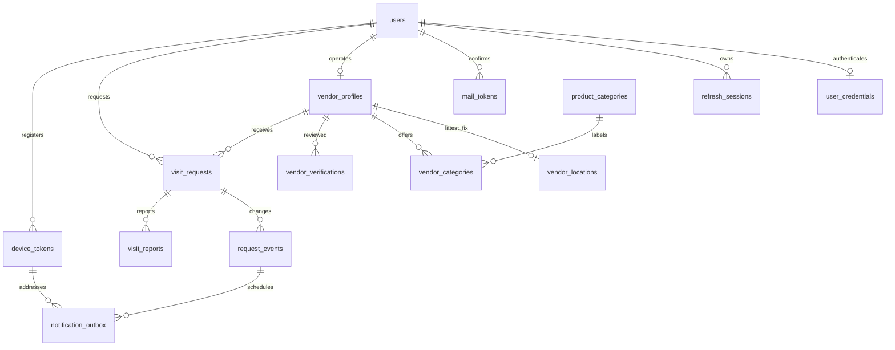

# Current database

Updated 4 November 2026. PostgreSQL 18 and PostGIS 3.6 run in Docker. Alembic head is `0006_notifications`. The tables below exist in the implemented model and migrations; `alembic_version` records schema revision.

## Relationships



Audit records and rate-limit buckets are also stored. The diagram emphasizes ownership; source migrations define the full foreign keys, checks and indexes.

| Table | Purpose and key rules |
|---|---|
| `users` | Canonical email, one lowercase role, status, language and verification/deletion metadata. Clients cannot select privileged roles. |
| `user_credentials` | Argon2id password hash, one credential row per user. |
| `refresh_sessions` | SHA-256 hash of each random opaque token, user/family, absolute expiry, replacement and revocation. No plaintext refresh tokens. |
| `rate_limit_buckets` | HMAC-derived identifiers and atomic counters with expiry; failed authentication does not roll them back. |
| `mail_tokens` | Hashed one-use reset/verification token, purpose and expiry. |
| `vendor_profiles` | One business per vendor owner, description, verification, availability and consent. A database check constrains online consent. |
| `product_categories` | Bilingual active catalogue; seed is idempotent and does not reactivate retired entries. |
| `vendor_categories` | Business/category association with composite key. |
| `vendor_verifications` | Minimal staff-reviewed evidence note and decision. Only one pending review per vendor. No government-ID uploads. |
| `vendor_locations` | One latest `geography(Point,4326)` per vendor, accuracy, captured/received times and GiST spatial index. |
| `visit_requests` | Participants, meeting point, status/version, expiry, idempotency key and payload hash; unique active pair. |
| `request_events` | Minimal workflow transition history committed with its visit change. |
| `visit_reports` | Participant issue and audited resolution state. |
| `admin_audit_records` | Actor, action, target, reason and timestamp for sensitive staff operations. |
| `device_tokens` | Installation, app kind, Expo project/token, authenticated user/session family and disable/last-seen state. |
| `notification_outbox` | Unique event/device/channel job, generic payload, leases, attempt/retry state, tickets/receipts and safe error codes. Composite ownership constraints prevent stale jobs targeting a transferred device. |

## Migrations

| Revision | Introduces |
|---|---|
| `0001_enable_postgis` | Spatial extension prerequisite |
| `0002_accounts` | Accounts, credentials, revocable refresh state and abuse counters |
| `0003_mail_tokens` | One-use mail state |
| `0004_vendors_locations` | Businesses, catalogue, reviews, audit and latest fix |
| `0005_visits_reports` | Versioned visits, events, participant reports and privacy constraints |
| `0006_notifications` | Session-bound installations and durable notification jobs |

SQLAlchemy metadata describes what code expects. A migration changes the database. Editing a model does not update an existing database automatically. Published migrations are retained; new schema changes need a new revision. Alembic comparison is restricted to the application schema and excludes extension-owned tables.

## Transactions and races

A request session is a unit of work. Services commit only after all related writes succeed. Events and outbox rows cannot survive a rolled-back transition. Provider network calls occur after the claim transaction has released database locks.

Account-first refresh locking prevents logout from missing a concurrently created refresh child. Sharing uses account/vendor/location lock order so offline deletion cannot race an old write back into discovery. Visit expected versions prevent stale screens silently overwriting another participant's action. Idempotency makes a repeated creation payload return the existing visit and rejects a changed payload using the same key.

Cleanup commits independent groups before taking locks used by another writer in a different order. Stale GPS cleanup locks vendor profiles with `SKIP LOCKED`, bounds candidates and rechecks the point's capture time before deletion. It preserves a writer's new fix.

## Spatial behavior

PostGIS constructors take longitude first: `ST_MakePoint(longitude, latitude)`. The geography type computes distances in metres on Earth. The GiST index narrows candidate searches; public membership and returned coordinates use the coarse grid to reduce precision inference. Discovery caps radius at 5 km and binds signed cursors to the actor and search.

Phone observations must be timezone-aware, finite, at most 90 seconds old, no more than 30 seconds ahead, at most 100 m uncertainty and newer than the stored fix. Production validates an approved polygon; local development uses a synthetic Chennai rectangle. GPS remains a report from an untrusted phone, not proof of physical presence.

## Retention implemented today

| Data | Current cleanup |
|---|---|
| Latest vendor fix | Replaced on update; erased atomically on offline/suspension/deletion; bounded maintenance removes points older than 90 seconds. Worker outages/backlogs can delay storage erasure. |
| Terminal visit meeting point/label/reason | Redacted after 24 hours; account deletion also erases its affected points. |
| Terminal visit/event history | Purged after 90 days with dependent cascade rules. |
| Completed notification payload | Cleared after seven days; unsent/receipt work has shorter obsolescence deadlines. |
| Disabled/stale device | Purged after 30 days. |
| Expired abuse buckets / mail tokens | Bounded expiry cleanup; mail-token hashes have a one-day grace. |
| Expired refresh history, minimal staff decisions/audit | No scheduled purge yet. Requires a documented retention/investigation window before real personal data is collected. Expired/revoked tokens grant no authority. |

Deletion initially anonymizes/revokes the account and cancels active work; it is not a claim that every audit row or old backup disappears immediately. Backup retention and encryption are separate operator duties.

## Inspect safely

From PowerShell:

```powershell
docker compose --env-file .env -f infrastructure/compose.yaml exec api alembic -c alembic.ini current
docker compose --env-file .env -f infrastructure/compose.yaml exec db psql -U mystreetvendor -d mystreetvendor -c 'SELECT version_num FROM alembic_version'
docker compose --env-file .env -f infrastructure/compose.yaml exec db psql -U mystreetvendor -d mystreetvendor -c 'SELECT PostGIS_Version()'
```

The last two commands use the example development account/database names; use your configured names if changed. Avoid selecting private points, credentials or token values merely to check connectivity. Integration fixtures create/drop only generated `msv_test_*` databases. Production roles and restore safety are described in [PRODUCTION.md](PRODUCTION.md) and [BACKUPS.md](BACKUPS.md).
