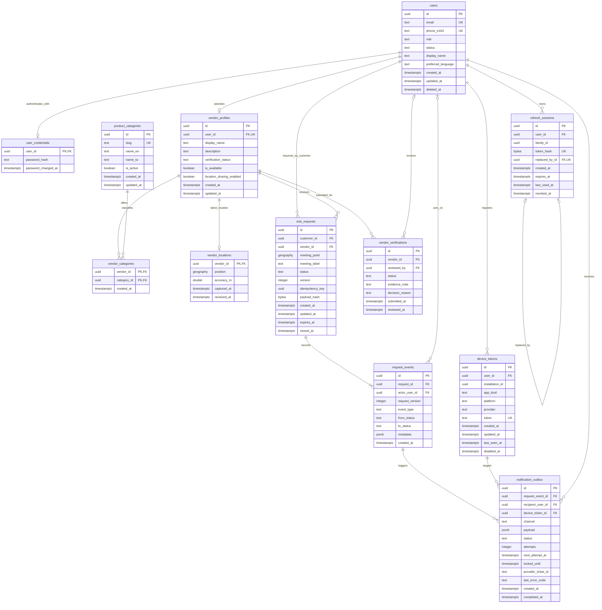

# Database design

## What exists in Phase 1

The running foundation uses PostgreSQL 18 with PostGIS 3.6. The initial Alembic migration establishes the PostGIS prerequisite and records its revision in `alembic_version`. **The business tables below are the Phase 0 design; they are not created in Phase 1.** They will be introduced, with tests, in the phases that use them.

The PostGIS Docker image normally enables PostGIS in its initial database. The migration still uses `CREATE EXTENSION IF NOT EXISTS postgis` so a newly created database can be prepared consistently. A downgrade must not blindly drop the extension: it might predate the migration, and later spatial columns depend on it. Application tables belong to `public`. The migration environment sets `SET LOCAL search_path TO public` during its transaction, preventing visible `tiger`/`topology` extension tables from entering application comparisons; it separately excludes PostGIS-owned `spatial_ref_sys`. Future business models must be imported into the migration environment before autogeneration. Do not treat extension tables as application tables to remove.

## Conventions

- Application-generated UUIDs identify records unless a natural composite key is simpler. They are identifiers, not authorization credentials.
- `timestamptz` stores an instant. APIs exchange ISO 8601 timestamps in UTC; a client can display Indian local time. PostgreSQL does not retain a timestamp's original timezone name.
- `created_at` and `updated_at` default to `now()`. Application services explicitly update `updated_at` on changes; a default alone does not update it automatically.
- In the column tables, `required` means `NOT NULL`. A nullable field defaults to `NULL` unless another default is stated. `generated UUID` means generated by the backend before insertion.
- Enum-like values use `text` with named `CHECK` constraints initially. This makes allowed values visible and avoids managing PostgreSQL enum types before they are needed.
- All primary keys automatically have unique B-tree indexes. Foreign keys do **not** automatically create an index on the referencing column; the indexes listed below cover expected lookups.
- Foreign keys use `ON DELETE RESTRICT` unless a section explicitly says otherwise. Account deletion initially anonymizes an account and revokes access; a controlled purge later removes records in dependency order.
- Authorization rules involving another table, such as “this account is a vendor,” are enforced by the backend transaction. A `CHECK` constraint is not a substitute for cross-table authorization.
- Retention periods below are proposed pilot defaults, not a statement of legal compliance. Confirm them before collecting real personal data. Cleanup jobs arrive with the features that need them.

## Complete proposed relationship diagram



The diagram shows key relationships. The column definitions and constraints below are authoritative; Mermaid's `geography` label abbreviates `geography(Point, 4326)`.

## 1. `users` — account identity and authorization status

| Column | PostgreSQL type | Nullability / default | Meaning |
|---|---|---|---|
| `id` | `uuid` | required, generated UUID, PK | Account identifier |
| `email` | `text` | nullable | Canonical email, required for initial email registration; erased on deletion |
| `phone_e164` | `text` | nullable | Reserved for a real verified-phone flow later |
| `role` | `text` | required | `customer`, `vendor`, or `admin`; assigned by trusted backend logic |
| `status` | `text` | required, `ACTIVE` | `ACTIVE`, `SUSPENDED`, or `DELETED` |
| `display_name` | `text` | required | 1–100 characters; anonymized when deleted |
| `preferred_language` | `text` | required, `en` | `en` or `ta` initially |
| `created_at` | `timestamptz` | required, `now()` | Creation instant |
| `updated_at` | `timestamptz` | required, `now()` | Last account change |
| `deleted_at` | `timestamptz` | nullable | Erasure/tombstone instant |

**Constraints and indexes:** named checks for allowed roles, statuses and languages; `email = lower(btrim(email))` when present; non-deleted email accounts require an email. Unique indexes on non-null `email` and non-null `phone_e164`; a deletion-state check makes `deleted_at` non-null exactly when status is `DELETED`. Passwords never go in this table. The API validates email syntax, size and the future E.164 phone format. One role per account is the initial product rule; add a role membership table only if multi-role accounts become a real requirement.

**Relationships and retention:** one credential record, many sessions and devices, optional vendor profile. Keep active accounts; erase direct identifiers promptly on a confirmed deletion request, revoke sessions and hide the vendor. Retain a deidentified UUID tombstone only while request/audit references need it. A subsequent purge handles references explicitly.

## 2. `user_credentials` — password verification data

| Column | Type | Nullability / default | Meaning |
|---|---|---|---|
| `user_id` | `uuid` | required, PK, FK → `users.id` | One password credential per account |
| `password_hash` | `text` | required | Encoded Argon2id hash, including salt and parameters |
| `password_changed_at` | `timestamptz` | required, `now()` | Credential lifecycle audit |

**Constraints and indexes:** PK is sufficient for login after finding the account by email. Do not index a password hash. The backend selects approved hash parameters and rehashes on login when needed; it never accepts a hash supplied by the mobile app. `ON DELETE CASCADE` is appropriate for an eventual hard account purge.

**Retention:** remove on account deletion. Password resets revoke sessions in the same logical operation. SMS/OTP records are deliberately absent until a legitimate provider and expiry/rate-limit design exist.

## 3. `refresh_sessions` — revocable token rotation chain

| Column | Type | Nullability / default | Meaning |
|---|---|---|---|
| `id` | `uuid` | required, generated UUID, PK | One issued refresh token |
| `user_id` | `uuid` | required, FK → `users.id` | Token owner |
| `family_id` | `uuid` | required | Groups tokens produced by one login session |
| `token_hash` | `bytea` | required, unique | SHA-256 digest of a cryptographically random high-entropy token |
| `replaced_by_id` | `uuid` | nullable, unique, FK → `refresh_sessions.id` | Successor after successful rotation |
| `created_at` | `timestamptz` | required, `now()` | Issued at |
| `expires_at` | `timestamptz` | required | Token expiration |
| `last_used_at` | `timestamptz` | nullable | Last successful use |
| `revoked_at` | `timestamptz` | nullable | Logout, rotation, replay detection or admin revocation |

**Constraints and indexes:** `octet_length(token_hash) = 32`, `expires_at > created_at`, and `replaced_by_id <> id` when present. Index `(user_id, family_id)` for revocation and `expires_at` for cleanup. The self-reference's unique index prevents two predecessors from claiming the same successor. Rotation locks the current session, verifies it is active, creates a successor in the same user/family, and revokes the predecessor in one transaction. The same-user/family invariant is checked in this trusted transaction. Replay of a revoked token revokes its entire family.

**Retention:** retain revoked/expired token hashes through the family's maximum refresh lifetime plus a short replay-investigation window, then purge. Never store raw refresh tokens or put them in logs. A future hard account purge cascades session deletion after revocation.

## 4. `vendor_profiles` — public vendor information and operating state

| Column | Type | Nullability / default | Meaning |
|---|---|---|---|
| `id` | `uuid` | required, generated UUID, PK | Vendor identifier |
| `user_id` | `uuid` | required, unique, FK → `users.id` | Vendor account owner |
| `display_name` | `text` | required | Public name, 1–100 characters |
| `description` | `text` | nullable | Plain-text product description, maximum 1,000 characters |
| `verification_status` | `text` | required, `PENDING` | `PENDING`, `VERIFIED`, `REJECTED`, `SUSPENDED` |
| `is_available` | `boolean` | required, `false` | Explicit vendor online/offline state |
| `location_sharing_enabled` | `boolean` | required, `false` | Explicit location-sharing consent state |
| `created_at` | `timestamptz` | required, `now()` | Profile creation |
| `updated_at` | `timestamptz` | required, `now()` | Last change |

**Constraints and indexes:** unique `user_id` implements one profile per vendor account. Check allowed verification statuses and text lengths. A check requires an available vendor to be `VERIFIED` and have `location_sharing_enabled = true`. The backend additionally requires an active vendor-role account and a fresh usable location before allowing discovery. A partial index on `id WHERE is_available AND verification_status = 'VERIFIED'` is optional after query measurements; the primary spatial index is on `vendor_locations`.

**Retention:** hide immediately on suspension, offline state or account deletion; anonymize public names on deletion. Verification history is separate. No user can set their own verification status.

## 5. `product_categories` — a small curated bilingual catalogue

| Column | Type | Nullability / default | Meaning |
|---|---|---|---|
| `id` | `uuid` | required, generated UUID, PK | Category identifier |
| `slug` | `text` | required, unique | Stable lowercase API key, for example `vegetables` |
| `name_en` | `text` | required | English label, 1–100 characters |
| `name_ta` | `text` | required | Tamil label, 1–100 characters |
| `is_active` | `boolean` | required, `true` | Available for new selections |
| `created_at` | `timestamptz` | required, `now()` | Creation |
| `updated_at` | `timestamptz` | required, `now()` | Last catalogue change |

**Constraints and indexes:** unique `slug`; check slug pattern `^[a-z0-9]+(-[a-z0-9]+)*$` and text lengths. The catalogue is small enough that no additional performance index is needed initially.

**Retention:** disable categories instead of deleting referenced rows. Product inventories, prices and purchases are separate future requirements; a category is not a product order.

## 6. `vendor_categories` — vendor/category membership

| Column | Type | Nullability / default | Meaning |
|---|---|---|---|
| `vendor_id` | `uuid` | required, PK part, FK → `vendor_profiles.id` | Vendor |
| `category_id` | `uuid` | required, PK part, FK → `product_categories.id` | Offered category |
| `created_at` | `timestamptz` | required, `now()` | Assignment |

**Constraints and indexes:** composite PK `(vendor_id, category_id)` prevents duplicates and covers profile lookups. Index `(category_id, vendor_id)` supports category-filtered discovery. Vendor deletion can cascade memberships; category deletion remains restricted. Backend transactions validate that newly selected categories are active.

**Retention:** remove when a vendor changes categories or is purged; no assignment history is needed for the initial MVP.

## 7. `vendor_locations` — latest position only

| Column | Type | Nullability / default | Meaning |
|---|---|---|---|
| `vendor_id` | `uuid` | required, PK, FK → `vendor_profiles.id` | One latest row per vendor |
| `position` | `geography(Point, 4326)` | required | WGS84 longitude/latitude position |
| `accuracy_m` | `double precision` | required | Reported horizontal accuracy in metres |
| `captured_at` | `timestamptz` | required | Device fix time |
| `received_at` | `timestamptz` | required, `now()` | Server receipt time |

**Constraints and indexes:** `accuracy_m >= 0 AND accuracy_m <= 100` for accepted MVP fixes; validate finite coordinates, latitude `[-90, 90]` and longitude `[-180, 180]` before constructing the geography. GiST index `USING gist(position)` supports nearby filtering. Index `received_at` supports stale-row cleanup if measurements justify it. `ON DELETE CASCADE` removes this row on a hard vendor purge.

**Update rules:** the backend derives the vendor from the authenticated account. Require verified/active vendor, availability, and explicit sharing consent. Reject fixes more than 90 seconds old, more than 30 seconds into the future, and fixes no newer than the stored `captured_at`. The server stamps `received_at`; the client cannot supply it. Use an upsert with `WHERE EXCLUDED.captured_at > vendor_locations.captured_at` to prevent delayed concurrent requests overwriting a newer fix. Perform the vendor state check and write under the appropriate transaction/row lock so an offline transition cannot race a location write into discovery. Treat speed jumps and improbable fixes as review/validation signals; GPS alone cannot prove the phone's physical presence.

**Retention:** replace the row on each update. Remove precise latest position when going offline or disabling sharing; stale positions are excluded immediately and removed by periodic cleanup. No detailed route-history table is planned for the MVP. Logs must not become an accidental location-history database.

## 8. `visit_requests` — the visit agreement and current state

| Column | Type | Nullability / default | Meaning |
|---|---|---|---|
| `id` | `uuid` | required, generated UUID, PK | Visit identifier |
| `customer_id` | `uuid` | required, FK → `users.id` | Requesting customer |
| `vendor_id` | `uuid` | required, FK → `vendor_profiles.id` | Intended vendor |
| `meeting_point` | `geography(Point, 4326)` | nullable | Required while active; erased after retention deadline |
| `meeting_label` | `text` | nullable | Optional short public-place description, maximum 250 characters |
| `status` | `text` | required, `PENDING` | Current lifecycle state |
| `version` | `integer` | required, `1` | Incremented on every state transition |
| `idempotency_key` | `uuid` | required | Customer-generated request-creation retry key |
| `payload_hash` | `bytea` | required | SHA-256 of the validated canonical creation payload |
| `created_at` | `timestamptz` | required, `now()` | Creation |
| `updated_at` | `timestamptz` | required, `now()` | Last state change |
| `expires_at` | `timestamptz` | required | Deadline for pending or active visit |
| `closed_at` | `timestamptz` | nullable | Terminal-state instant |

**Constraints and indexes:** `version >= 1`; `octet_length(payload_hash) = 32`; allowed states `PENDING`, `ACCEPTED`, `APPROACHING`, `ARRIVED`, `COMPLETED`, `DECLINED`, `CANCELLED`, `EXPIRED`. An active-state check requires a non-null `meeting_point` and null `closed_at`; terminal states require `closed_at`. `expires_at > created_at`. Unique `(customer_id, idempotency_key)` makes creation retries safe; reuse with a different payload returns conflict. A partial unique index on `(customer_id, vendor_id)` for active states prevents duplicate simultaneous visits between the same pair. It does not forbid the vendor from accepting different customers.

Index `(customer_id, created_at DESC, id)` and `(vendor_id, created_at DESC, id)` for bounded history pagination. A partial index on `expires_at` for active states supports expiry scans. Add no GiST meeting-point index until there is a measured spatial query that needs it; arrival normally loads one request by its PK.

**Relationships and authorization:** customer-role ownership and vendor-role membership are checked by the backend. Requests cannot target the customer's own vendor identity. History access is limited to participants and audited administrators. A completed visit does not assert that a purchase happened.

**Retention:** retain minimal state history for 90 days during the pilot, then purge or aggregate after the policy is approved. Clear `meeting_point` and `meeting_label` within 24 hours of a terminal state; authorization stops precise location access immediately, without waiting for cleanup. Account deletion triggers earlier erasure where appropriate. Never copy exact meeting coordinates into event metadata, push payloads or logs.

## 9. `request_events` — immutable transition audit

| Column | Type | Nullability / default | Meaning |
|---|---|---|---|
| `id` | `uuid` | required, generated UUID, PK | Stable event identifier |
| `request_id` | `uuid` | required, FK → `visit_requests.id` | Request |
| `actor_user_id` | `uuid` | nullable, FK → `users.id` | Customer/vendor/admin; null for system expiry or arrival |
| `request_version` | `integer` | required | Request version produced by this event |
| `event_type` | `text` | required | Versioned event name from the API contract |
| `from_status` | `text` | nullable | Null only for creation |
| `to_status` | `text` | required | New request state |
| `metadata` | `jsonb` | required, `'{}'::jsonb` | Small allowlisted details, such as cancellation reason code |
| `created_at` | `timestamptz` | required, `now()` | Committed event's creation instant |

**Constraints and indexes:** unique `(request_id, request_version)` prevents duplicate transition events. Check positive version, valid statuses and `jsonb_typeof(metadata) = 'object'`. Index `(request_id, created_at, id)` for ordered audit retrieval. The backend event allowlist and state machine validate `event_type`, actor and transition. Audit rows are append-only for normal application operations.

**Retention:** aligned with their parent request's 90-day pilot policy; cascade only during an explicit request-history purge. Keep metadata minimal and coordinate-free. If an audit must be retained longer for an approved investigation, restrict access and record the retention exception.

## 10. `device_tokens` — addressable app installations

| Column | Type | Nullability / default | Meaning |
|---|---|---|---|
| `id` | `uuid` | required, generated UUID, PK | Token registration |
| `user_id` | `uuid` | required, FK → `users.id` | Current authenticated owner |
| `installation_id` | `uuid` | required | App-created installation identifier; not an authentication secret |
| `app_kind` | `text` | required | `customer` or `vendor` |
| `platform` | `text` | required | `android` or `ios` |
| `provider` | `text` | required, `expo` | Push adapter identifier |
| `token` | `text` | required, unique | Expo push token; sensitive, never public |
| `created_at` | `timestamptz` | required, `now()` | First registration |
| `updated_at` | `timestamptz` | required, `now()` | Last token/ownership update |
| `last_seen_at` | `timestamptz` | required, `now()` | Last authenticated registration/refresh |
| `disabled_at` | `timestamptz` | nullable | Logout, invalid provider token or account restriction |

**Constraints and indexes:** checks on app/platform/provider allowlists. Unique `(installation_id, app_kind)` prevents duplicate registrations for the same installation. Unique `(id, user_id)` supports the outbox's composite ownership FK. Index `(user_id) WHERE disabled_at IS NULL` for fanout. Authenticated upsert transfers ownership on account switching and removes old-account delivery records for that token before the transfer, so a previous account cannot receive another account's alerts.

**Retention:** disable immediately on logout/account deletion and on permanent provider rejection. Purge disabled/stale registrations after 30 days; do not reuse a disabled token without fresh authenticated registration. Database access controls and encrypted backups protect token values; add application-level encryption if the threat assessment requires it. Device tokens are delivery addresses, not access tokens.

## 11. `vendor_verifications` — staff-reviewed verification attempts

| Column | Type | Nullability / default | Meaning |
|---|---|---|---|
| `id` | `uuid` | required, generated UUID, PK | Verification submission |
| `vendor_id` | `uuid` | required, FK → `vendor_profiles.id` | Subject vendor |
| `reviewed_by` | `uuid` | nullable, FK → `users.id` | Reviewing admin |
| `status` | `text` | required, `PENDING` | `PENDING`, `VERIFIED`, `REJECTED` |
| `evidence_note` | `text` | nullable | Minimal internal staff note; maximum 1,000 characters |
| `decision_reason` | `text` | nullable | Sanitized decision explanation; maximum 500 characters |
| `submitted_at` | `timestamptz` | required, `now()` | Submission |
| `reviewed_at` | `timestamptz` | nullable | Decision instant |

**Constraints and indexes:** one `PENDING` attempt per vendor via a partial unique index. A check requires pending rows to have no reviewer/review time, and decided rows to have both. `reviewed_at >= submitted_at` when present. Index `(vendor_id, submitted_at DESC)` for audit and `(submitted_at) WHERE status = 'PENDING'` for the review queue. The backend verifies an active admin, disallows self-review and updates the profile's verification state in the same transaction as the decision.

**Retention:** initial workflow stores a minimal staff decision, not scanned government IDs. If documentary evidence becomes necessary, design purpose, consent, access, encryption and deletion before collection. Retain minimal decisions for the vendor account's life plus 90 days after closure; remove unnecessary notes earlier. Suspension belongs to account/profile operating status and is separately audited, not a new verification outcome.

## 12. `notification_outbox` — committed, retryable device notifications

| Column | Type | Nullability / default | Meaning |
|---|---|---|---|
| `id` | `uuid` | required, generated UUID, PK | Stable notification/delivery identifier |
| `request_event_id` | `uuid` | required, FK → `request_events.id` | Committed source event |
| `recipient_user_id` | `uuid` | required, FK → `users.id` | Authorized recipient |
| `device_token_id` | `uuid` | required | Device, covered by composite FK below |
| `channel` | `text` | required, `PUSH` | `PUSH` initially |
| `payload` | `jsonb` | required | Allowlisted event ID, request ID and generic message |
| `status` | `text` | required, `PENDING` | `PENDING`, `SENDING`, `RECEIPT_PENDING`, `DELIVERED`, `FAILED` |
| `attempts` | `integer` | required, `0` | Delivery attempts |
| `next_attempt_at` | `timestamptz` | required, `now()` | Retry/poll deadline |
| `locked_until` | `timestamptz` | nullable | Recoverable processing lease |
| `provider_ticket_id` | `text` | nullable | Expo ticket for later receipt polling |
| `last_error_code` | `text` | nullable | Sanitized provider code; no token or raw payload |
| `created_at` | `timestamptz` | required, `now()` | Enqueued with the business transaction |
| `completed_at` | `timestamptz` | nullable | Receipt success or permanent failure |

**Constraints and indexes:** FK `(device_token_id, recipient_user_id)` → `device_tokens(id, user_id)` ensures the target belonged to the intended recipient. Unique `(request_event_id, device_token_id, channel)` prevents duplicate enqueueing. Check allowed statuses/channel, `attempts >= 0` and JSON object payload. Terminal statuses require `completed_at`; nonterminal ones have none. Index `(next_attempt_at, id)` for pending/receipt work and `locked_until` for abandoned leases, using partial predicates matching dispatcher queries. Index `recipient_user_id` supports deletion cleanup.

**Delivery behavior:** enqueue only for registered, enabled, currently authorized devices. Before send, recheck token ownership, enabled state, account status and event relevance; a cancelled visit can make an old arrival notification obsolete. Token transfer must remove **all** old-account outbox rows referencing that token before changing its owner, within one transaction; retain only sanitized aggregate counts if needed. A single-instance polling loop can process a small batch with `FOR UPDATE SKIP LOCKED`, assign short leases, commit, call Expo outside the transaction, and record results. Retries use bounded exponential backoff. Expired leases recover after crashes. Ticket acceptance is not proof of device delivery; poll receipts and handle permanent token errors. Here `DELIVERED` means a successful provider receipt/handoff, not proof that the device displayed the alert or the person read it.

**Retention:** remove completed payloads after 7 days during the pilot, retain sanitized aggregate success/failure metrics, and cap retry age/attempts. Purge on account/token deletion as appropriate. Cascading history purges remove completed outbox rows before their source events. Exactly-once delivery across PostgreSQL and an external push provider is not guaranteed: a crash after sending but before recording can cause a retry. Stable notification IDs let the client ignore duplicate in-app handling; an operating system can still show duplicate alerts.

## Request transitions, concurrency and atomicity

All transitions run in the backend, not in mobile component state.

| Current state | Next state | Allowed actor / condition |
|---|---|---|
| `PENDING` | `ACCEPTED` | Target vendor, before expiry |
| `PENDING` | `DECLINED` | Target vendor |
| `PENDING` | `CANCELLED` | Owning customer or target vendor |
| `PENDING` | `EXPIRED` | Backend when pending deadline passes |
| `ACCEPTED` | `APPROACHING` | Target vendor or backend distance evaluation using fresh accurate fixes |
| `APPROACHING` | `ARRIVED` | Backend after fresh accurate proximity checks |
| `ACCEPTED`, `APPROACHING`, `ARRIVED` | `CANCELLED` | Either participant, with reason |
| `ACCEPTED`, `APPROACHING`, `ARRIVED` | `EXPIRED` | Backend when active visit deadline passes |
| `ARRIVED` | `COMPLETED` | Vendor confirms visit completion |
| Any terminal state | None | Immutable; create a new request for a new visit |

Pilot defaults: pending requests expire after 5 minutes; acceptance sets an active visit deadline of 60 minutes. These are configurable product policies, not guarantees of vendor arrival. Going offline does not automatically convert an accepted visit into a completed or cancelled one; clients see tracking unavailable and may cancel, while the deadline still applies.

For each transition:

1. Begin a transaction and load the request with a row lock, then verify actor ownership, current state, expiry and the client's expected `version`.
2. Update status and increment the version. Concurrent transitions serialize; a stale expected version receives `409 Conflict` rather than silently overwriting another action.
3. Insert one `request_events` record for the resulting version. Starting in Phase 7, insert authorized device `notification_outbox` rows in this same transaction; Phase 5 does not create the notification table early.
4. Commit all changes together. Rollback leaves all of them unchanged. Publish live WebSocket updates only after commit.

An arrival processor uses the same transition path and event uniqueness to prevent repeated fixes generating repeated arrival events. A customer/vendor pair's active unique index also handles two simultaneous create requests. Use a consistent lock order when a transaction also locks vendor availability or a device token. On deadlock or serialization errors, retry only a bounded, idempotent transaction; do not replay an external push call inside it. PostgreSQL documents both [row-lock behavior](https://www.postgresql.org/docs/18/explicit-locking.html) and [partial unique indexes](https://www.postgresql.org/docs/18/indexes-partial.html).

## Spatial queries: metres, coordinate order and privacy

Store GPS positions as `geography(Point, 4326)`. A point is constructed **longitude first, latitude second**, for example Chennai longitude `80.2707`, latitude `13.0827`:

```sql
SELECT ST_SetSRID(ST_MakePoint(80.2707, 13.0827), 4326)::geography;
```

The `4326` coordinate values are degrees, but the **geography overloads** of `ST_DWithin` and `ST_Distance` take or return metres. Using `geometry` with SRID 4326 for a metre-radius comparison would instead compare degrees. The relevant units and index-aware filtering are defined in the [PostGIS ST_DWithin documentation](https://postgis.net/docs/ST_DWithin.html); geodesic distance is defined in [ST_Distance](https://postgis.net/docs/ST_Distance.html).

This parameterized query is a **Phase 4 implementation blueprint**, not executable against Phase 1's intentionally empty business schema. `:name` placeholders are bound by SQLAlchemy, never interpolated into SQL strings. The API first validates coordinate bounds, a positive capped radius, and a bounded result limit.

```sql
WITH query_point AS (
    SELECT ST_SetSRID(
        ST_MakePoint(:longitude, :latitude), 4326
    )::geography AS position
)
SELECT vp.id,
       vp.display_name,
       floor(ST_Distance(vl.position, q.position) / 250)::integer * 250
           AS distance_band_start_m
FROM vendor_locations AS vl
JOIN vendor_profiles AS vp ON vp.id = vl.vendor_id
JOIN users AS owner ON owner.id = vp.user_id
CROSS JOIN query_point AS q
WHERE owner.status = 'ACTIVE'
  AND vp.verification_status = 'VERIFIED'
  AND vp.is_available = true
  AND vp.location_sharing_enabled = true
  AND vl.captured_at >= now() - interval '90 seconds'
  AND vl.captured_at <= now() + interval '30 seconds'
  AND vl.received_at >= now() - interval '90 seconds'
  AND vl.accuracy_m <= 100
  AND ST_DWithin(vl.position, q.position, :radius_m)
  AND (
      CAST(:category_id AS uuid) IS NULL
      OR EXISTS (
          SELECT 1
          FROM vendor_categories AS vc
          JOIN product_categories AS pc ON pc.id = vc.category_id
          WHERE vc.vendor_id = vp.id
            AND vc.category_id = CAST(:category_id AS uuid)
            AND pc.is_active = true
      )
  )
ORDER BY distance_band_start_m, vp.id
LIMIT :limit;
```

The query deliberately returns no precise coordinates. `ST_DWithin` narrows the spatial candidates; `ST_Distance` calculates distances for those candidates. Distance bands allow approximate ordering without sending exact metres. They are **not a complete privacy guarantee**: repeated searches from different points can still reveal information. Discovery must additionally use capped/bucketed radii, rate limits, stable coarse map areas, and controls against enumeration. Map discovery markers represent a coarse area, not this private position. Exact tracking is a separate participant-authorized query available only during an accepted active visit, with permission checked on every request/event and revoked when it ends.

For cursor pagination, use `(distance_band_start_m, vendor_id)` with an opaque signed cursor bound to the normalized search origin, radius and filters. Locations move between pages, so results are best-effort and must be deduplicated by vendor ID. Reset the cursor when the search changes. Do not expose all rows to the phone for client-side distance filtering.

Arrival checks load the one authorized request and compare its meeting point with the latest eligible vendor position. Pilot defaults require two consistent fixes at least 5 seconds apart, each within 50 metres of the meeting point, no older than 30 seconds and with reported accuracy no worse than 30 metres. These thresholds are configurable; reported GPS accuracy can be too poor to make an arrival claim. Keep only the first qualifying candidate's timestamp/position in short-lived process memory, resetting it on disconnect, stale data or restart; this is not a route-history store. Recheck all conditions against the active request on the second fix. The backend creates one transition/event rather than treating every nearby GPS update as a new arrival.

## Migration and database verification policy

Run migrations explicitly before serving new schema-dependent code. Never replace Alembic with `Base.metadata.create_all()` at application startup. Keep the migration role's DDL/extension privileges separate from a restricted runtime role before production; the local development credential is not the production privilege model.

Phase 1 verification must prove:

1. A real PostgreSQL query succeeds through SQLAlchemy.
2. PostGIS functions are available, including a small geography-distance query.
3. Alembic upgrades a separate clean test database to the expected head and can apply the baseline again without duplicating it.
4. Database errors produce a safe unhealthy API response, and service recovery restores a healthy response.

The integration test database must be dedicated and disposable. Never run schema downgrade/drop tests against the development data volume. A mock or SQLite test cannot prove PostGIS works. The exact PowerShell commands live in [DEPLOYMENT.md](DEPLOYMENT.md) and [DEBUGGING.md](DEBUGGING.md); actual executed results are recorded separately from this design.

Later migrations add a table only when its feature is implemented. Each phase adds focused constraints, permission, transaction and migration tests, including competing requests, stale GPS updates and terminal-state privacy. Check spatial plans with `EXPLAIN (ANALYZE, BUFFERS)` using realistic fixtures before adding caches, partitioning or replicas.

## Check your understanding

1. Why is `geography(Point, 4326)` useful for a radius measured in metres, while `geometry` with the same SRID can be misleading?
2. Why must a request update, its audit event and its notification-outbox rows commit in one transaction?
3. Why does creating a SQLAlchemy engine alone fail to prove the database connection works?
