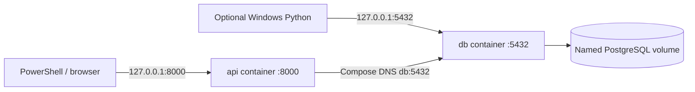
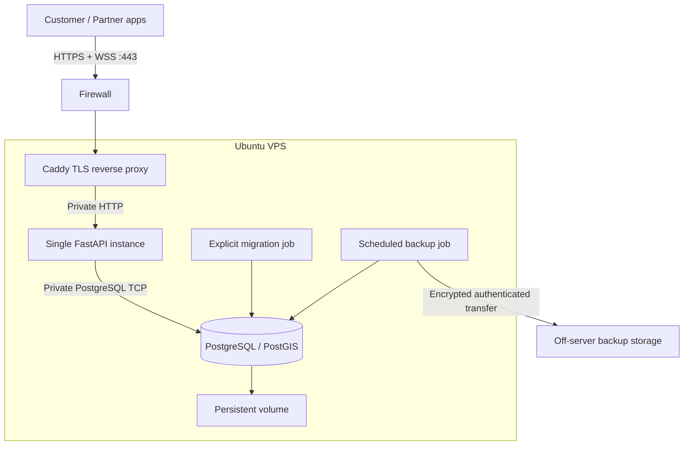

# Development and deployment

Status: Phase 0 design and implemented Phase 1 local foundation. See [VERIFICATION.md](VERIFICATION.md) for executed checks. Production deployment is a Phase 10 design, not a currently provisioned service.

## Windows prerequisites

Use PowerShell from the repository root. Docker Desktop must run **Linux containers**, with a working WSL 2 backend. Check [Docker's Windows instructions](https://docs.docker.com/desktop/setup/install/windows-install/) if the engine cannot start. Local Python is optional when using containers; Python 3.13 is selected for host debugging. Git provides local checkpoints.

```powershell
Set-Location 'C:\Users\prana\Desktop\mystreetvendor'
$taskDockerBin = Join-Path $env:LOCALAPPDATA 'Programs\DockerDesktop\resources\bin'
if (Test-Path -LiteralPath $taskDockerBin) { $env:PATH = "$taskDockerBin;$env:PATH" }
docker version
docker compose version
python --version
git --version
```

The PATH change affects this PowerShell session only. For an all-users Docker installation, use `C:\Program Files\Docker\Docker\resources\bin` instead. A successful client version alone does not prove the Linux engine is reachable: the `Server` section must also respond.

## Environment configuration

The root `.env.example` describes local configuration. Copy it once to `.env`, then replace the example password with a generated local secret. `.env` is ignored by Git and excluded from the image build context. Do not overwrite an existing `.env` when repeating setup.

```powershell
if (-not (Test-Path -LiteralPath '.env')) { Copy-Item -LiteralPath '.env.example' -Destination '.env' }
notepad .env
```

`POSTGRES_DB`, `POSTGRES_USER` and `POSTGRES_PASSWORD` initialize a new database volume. The application uses these same values. `POSTGRES_HOST=127.0.0.1` is for Python running on Windows; Compose overrides it to `db` inside the API container. `POSTGRES_PORT` is the Windows published database port; the internal port is always 5432. `API_PORT` is the Windows HTTP port.

Compose's `--env-file .env` resolves `${...}` expressions in its YAML. A container receives only the explicit `environment` entries configured for that service. Pydantic reads the root `.env` for host Python processes; container processes receive environment variables. These are different mechanisms.

Avoid pasting `.env`, resolved Compose output, SQL connection strings, or raw exception traces into public issues. Changing initialization credentials in `.env` does not change credentials already stored in a named volume; see [DEBUGGING.md](DEBUGGING.md).

## Container workflow

The Phase 1 workflow is:

```powershell
docker compose --env-file .env -f infrastructure/compose.yaml config --quiet
docker compose --env-file .env -f infrastructure/compose.yaml build
docker compose --env-file .env -f infrastructure/compose.yaml up -d --wait db
docker compose --env-file .env -f infrastructure/compose.yaml run --rm api alembic -c alembic.ini upgrade head
docker compose --env-file .env -f infrastructure/compose.yaml up -d --wait api
Invoke-RestMethod -Uri 'http://127.0.0.1:8000/health'
Start-Process 'http://127.0.0.1:8000/docs' -WindowStyle Hidden
```

If `API_PORT` changes, use that port in URLs. The migration command deliberately runs before starting the API. Startup must not silently change database schema. `depends_on: condition: service_healthy` waits for PostgreSQL acceptance of connections, but does not apply migrations. `/health` checks PostgreSQL and working PostGIS; use Alembic separately to inspect migration state.

```powershell
docker compose --env-file .env -f infrastructure/compose.yaml run --rm api alembic -c alembic.ini current
docker compose --env-file .env -f infrastructure/compose.yaml run --rm api alembic -c alembic.ini heads
docker compose --env-file .env -f infrastructure/compose.yaml ps
docker compose --env-file .env -f infrastructure/compose.yaml logs --tail 100 api db
docker compose --env-file .env -f infrastructure/compose.yaml down
```

`down` stops/removes this project's containers and network but keeps its named database volume. Do not add `--volumes` as a routine repair. PostgreSQL 18 stores data under the named volume mounted at `/var/lib/postgresql`, not the older version's `/var/lib/postgresql/data` target.

## Tests

Unit tests work without a running database. Integration tests are opt-in and use uniquely named disposable PostgreSQL databases on the local development server. They never downgrade or drop the development database. The test account needs permission to create and remove its own test databases; this is a development capability, not a production API privilege. The development image includes the test dependencies; a production image without development tools is a Phase 10 task.

```powershell
docker compose --env-file .env -f infrastructure/compose.yaml run --rm api python -m pytest
docker compose --env-file .env -f infrastructure/compose.yaml run --rm -e RUN_DB_TESTS=1 api python -m pytest
```

The first command reports integration tests as skipped. The second executes both groups and fails if the database is unreachable. Test isolation includes a database created from `template0`, which has no preinstalled PostGIS, so the initial migration must really enable it.

## Run Python on Windows for breakpoints

Keep PostgreSQL in Docker and stop the container API before using the same HTTP port locally. Activation is optional: calling the virtual environment's Python avoids PowerShell execution-policy changes.

```powershell
python -m venv .venv
.\.venv\Scripts\python.exe -m pip install -c backend/requirements.lock -e './backend[test]'
docker compose --env-file .env -f infrastructure/compose.yaml up -d --wait db
docker compose --env-file .env -f infrastructure/compose.yaml stop api
.\.venv\Scripts\python.exe -m alembic -c backend/alembic.ini upgrade head
.\.venv\Scripts\python.exe -m uvicorn app.main:create_app --factory --reload --host 127.0.0.1 --port 8000
.\.venv\Scripts\python.exe -m pytest -c backend/pyproject.toml backend/tests
$env:RUN_DB_TESTS = '1'
.\.venv\Scripts\python.exe -m pytest -c backend/pyproject.toml backend/tests
Remove-Item Env:RUN_DB_TESTS
```

Run the server command in one terminal and tests in another. Uvicorn's `--reload` is for development. Do not launch a second listener on a port already used by the API container. New code requires a container rebuild; this foundation does not use a source bind mount.

## Networking: who connects to whom?



The Compose project network supplies DNS for `db`. Inside the API container, `localhost` means that container itself. The SQLAlchemy engine manages a small reusable connection pool; Psycopg sends PostgreSQL protocol messages over TCP. SQLAlchemy sessions borrow connections and release them when the request finishes. A connection URL is built from individual values, rather than manually concatenating a password into a URL.

Local ports bind to loopback. Future physical-phone testing requires explicitly publishing the API to a trusted LAN interface and allowing only that development port through Windows Firewall. The phone uses the PC's LAN IPv4 address, not `localhost`. Do not publish PostgreSQL for phones. This LAN setup and real-device testing are not performed in Phase 1.

## Ubuntu VPS design — future Phase 10



Only Caddy exposes public HTTP/HTTPS ports; PostgreSQL has no published host port and the API is private to the proxy. Limit SSH to authorized operators. Use a maintained Ubuntu release, security updates, least-privilege containers, protected secrets, and separate database owner/migrator and restricted application accounts. Phase 1's local bootstrap database account is privileged for learning and migration tests; do not reuse it for production.

Phase 10 adds the actual production Compose override, Caddyfile, TLS domain, secrets provisioning, structured JSON logs with request IDs, resource limits, monitoring and backup scheduling. There is no deployed HTTPS/WSS endpoint or Caddy container in Phase 1. Docker image pins and vulnerability scans are reviewed before deployment.

Deploy steps: verify backup and restore evidence, build/test versioned images, pause incompatible writes if necessary, run reviewed additive migrations, start the new image, verify readiness and key workflows, then monitor errors/latency. Keep the previous image digest for rollback. Prefer expand/contract schema changes so the previous API can run during rollback. A destructive schema downgrade is not a general rollback strategy.

## Backup and restore design

Use daily encrypted off-server logical backups plus retention and alerting; add WAL archiving/PITR if measured recovery requirements need it. Initial target: daily restore point, recovery within several hours, to be tested before a pilot. Track actual backup age and restore duration. Back up database roles separately where needed (`pg_dumpall --globals-only`); `pg_dump` alone does not capture cluster roles.

For local manual checks, use PostgreSQL tools in the container and copy the binary dump as a file. Do not pipe custom-format binary backups through Windows PowerShell 5.1 text redirection.

```powershell
New-Item -ItemType Directory -Path backups -Force | Out-Null
docker compose --env-file .env -f infrastructure/compose.yaml exec -T db sh -c 'pg_dump -U "$POSTGRES_USER" -d "$POSTGRES_DB" -Fc -f /tmp/mystreetvendor.dump'
docker compose --env-file .env -f infrastructure/compose.yaml cp db:/tmp/mystreetvendor.dump ./backups/mystreetvendor.dump
docker compose --env-file .env -f infrastructure/compose.yaml exec -T db sh -c 'createdb -U "$POSTGRES_USER" -T template0 mystreetvendor_restore_check'
docker compose --env-file .env -f infrastructure/compose.yaml exec -T db sh -c 'pg_restore -U "$POSTGRES_USER" -d mystreetvendor_restore_check --exit-on-error /tmp/mystreetvendor.dump'
```

Use a new restore-check name if that database already exists. Inspect restored rows, extension versions and Alembic revision before considering a backup usable. These manual backup examples are not an implemented automated backup service. Production restore tests must run in an isolated environment, never over a live database. Keep backup credentials separate from runtime API credentials, encrypt backups and apply deletion/retention policies.

## Sources checked for the foundation

- [Docker Compose startup order and readiness](https://docs.docker.com/compose/how-tos/startup-order/)
- [PostGIS container versions, initialization and volume paths](https://github.com/postgis/docker-postgis)
- [SQLAlchemy PostgreSQL Psycopg dialect](https://docs.sqlalchemy.org/en/21/dialects/postgresql.html#module-sqlalchemy.dialects.postgresql.psycopg)
- [Starlette TestClient and its HTTPX2 dependency](https://starlette.dev/testclient/)
- [Alembic tutorial](https://alembic.sqlalchemy.org/en/latest/tutorial.html)
