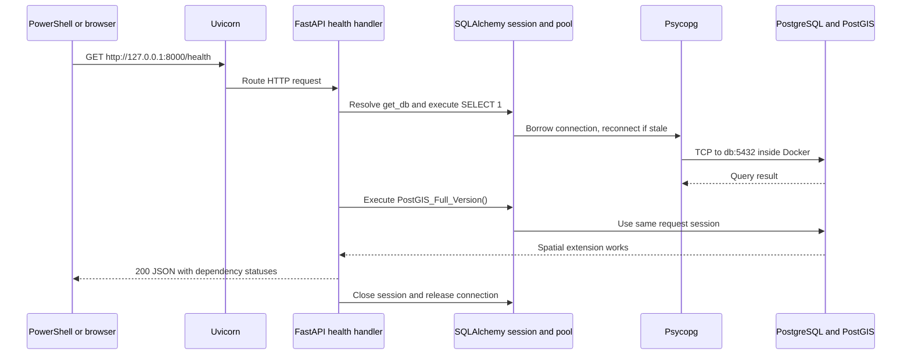

# Every file and how the foundation works

This guide covers all maintained files in the Phase 0/1 repository. No customer/vendor app, authentication service, business model or production proxy has been generated.

## Repository and documentation

| File | Purpose and when to edit it |
|---|---|
| `README.md` | Starting point: scope, setup, test commands and documentation links. |
| `.env.example` | Safe configuration template. It contains a placeholder password, not the working local secret. |
| `.gitignore` | Keeps real environment files, Python environments, caches, build output and backups out of commits. |
| `.gitattributes` | Makes maintained text files use consistent line endings on Windows and inside Linux images. |
| `docs/ARCHITECTURE.md` | Full planned system, module boundaries, mobile architecture, diagrams, risks and tradeoffs. |
| `docs/DATABASE.md` | Proposed business schema, ER diagram, constraints, spatial SQL, retention and current migration boundaries. |
| `docs/API.md` | Current health contract and clearly marked future REST/WebSocket contracts. |
| `docs/SECURITY.md` | Planned authentication, authorization, privacy and threat controls, plus current development limitations. |
| `docs/DEPLOYMENT.md` | Exact PowerShell workflows, Docker networking, optional host Python, and future VPS/backup design. |
| `docs/DEBUGGING.md` | Commands for finding which layer failed, common root causes, breakpoints and resolved setup issues. |
| `docs/ROADMAP.md` | Ordered phases, acceptance criteria, pilot plan, scaling evidence and learning questions. |
| `docs/FILE_GUIDE.md` | This file: an implementation walkthrough and file reference. |
| `docs/VERIFICATION.md` | Actual test/check results and the boundary between verified local behavior and future work. |

## Backend source

| File | Responsibility |
|---|---|
| `backend/pyproject.toml` | Python package metadata, exact direct dependency versions, optional test dependencies, and Pytest configuration. |
| `backend/requirements.lock` | Exact resolved dependency constraints. Both Windows and Linux installations use these constraints; platform-only dependencies are installed only where required. It is consumed with `-c`, alongside the package's declared dependencies. |
| `backend/app/__init__.py` | Declares the application package; imports no settings and makes no network connection. |
| `backend/app/config.py` | `Settings` validates configuration. Its `database_url` property uses `URL.create` so password punctuation is not mistaken for URL syntax. `SecretStr` masks the password in normal representations. |
| `backend/app/database.py` | `create_db_engine` constructs the connection pool; `get_db` yields one session for one request and closes it afterward. `Base` holds metadata for models added in later phases. |
| `backend/app/health.py` | Defines the health response and route. `health` executes a PostgreSQL query, then a PostGIS query. It returns 503 with safe dependency status when either fails. |
| `backend/app/main.py` | `create_app` wires the engine, session factory and router together. The lifespan handler disposes the pool on shutdown. Uvicorn invokes this factory; there is no global app that connects at import. |
| `backend/Dockerfile` | Builds the Python 3.13 development image, installs pinned dependencies and tests, then runs Uvicorn as a non-root user. Only its Pytest cache directory needs write permission under `/app`. |
| `backend/.dockerignore` | Excludes caches, environment files and build output from the backend image context. The root `.env` is also outside that context. |

## Migrations

| File | Responsibility |
|---|---|
| `backend/alembic.ini` | Migration directory and logging settings. `%(here)s` makes paths relative to this file, so Windows and Docker commands can use the same configuration. No password is stored here. |
| `backend/migrations/env.py` | Connects Alembic to the same settings as FastAPI. Supports ordinary online migrations, offline SQL output, and a supplied connection for isolated tests. Restricts comparisons to application objects. |
| `backend/migrations/script.py.mako` | Template used by `alembic revision` to create future migration files with `upgrade`/`downgrade` functions. It is not an executed application module. |
| `backend/migrations/versions/0001_enable_postgis.py` | Initial revision. Enables PostGIS if absent. Alembic records the revision in its own `alembic_version` table. Downgrade removes the revision record but intentionally preserves a potentially shared extension. |

There is no `create_all()` call: schema changes are explicit migrations. The image's extension tables are distinct from our future business tables. The complete proposed schema remains documentation until its feature phases begin.

## Tests and infrastructure

| File | Responsibility |
|---|---|
| `backend/tests/conftest.py` | Shared test fixtures: known unit configuration, mocked session, FastAPI dependency override and disposable database sandbox. Test database names are generated/validated before creation and deletion. |
| `backend/tests/test_config.py` | Four tests: safe URL/password representation, missing password, empty password and environment parsing. |
| `backend/tests/test_health.py` | Three unit tests: healthy response, safe database failure and distinguishable PostGIS failure. These do not prove real connectivity on their own. |
| `backend/tests/test_database.py` | Three opt-in integration tests: clean upgrade/repeated upgrade, spatial metres with real health before/after migration, and downgrade/re-upgrade/schema comparison with a visible nonapplication schema table. |
| `infrastructure/compose.yaml` | Runs `db` and `api`, supplies environment variables, maps loopback ports, waits for readiness, and persists PostgreSQL in a named volume. It does not silently run migrations. |

## Local generated items

- `.env`: generated local secret/configuration file, ignored by Git. Keep it private. `POSTGRES_HOST=127.0.0.1` supports host Python; Compose overrides it to `db` inside containers.
- `.venv/`: isolated Windows Python interpreter and installed packages, ignored by Git. It can be recreated from the package metadata and constraints.
- `.git/`: local Git history. The Phase 0 documentation and Phase 1 foundation have separate checkpoints.
- `__pycache__/`, `.pytest_cache/`, `*.egg-info/`: disposable Python/test/package metadata, ignored by Git. Docker's test cache lives inside its disposable test container.
- `mystreetvendor_postgres_data`: a **Docker named volume**, not a repository file. It contains the database cluster. Container removal does not erase it.

## Trace one health request

Uvicorn owns the HTTP listener. FastAPI validates inputs, resolves dependencies and serializes outputs. SQLAlchemy manages the pool and transaction/session boundary. Psycopg is the actual PostgreSQL protocol driver. PostgreSQL executes SQL; PostGIS supplies spatial functions inside that same database process. Docker supplies service DNS and networking; it does not run SQL itself.

A new SQLAlchemy engine is not proof of connectivity: it connects lazily on the first SQL operation. A session closes after each request; connections may remain open in the pool for reuse. Read-only health sessions roll back their implicit transaction when closed. Later write services must commit their complete business transaction explicitly and handle rollback on failure.

`pool_pre_ping=True` tests a borrowed connection before reuse after a database restart. Connection and pool waits are bounded; SQL statements have a five-second timeout. These limits prevent common prolonged waits, but they are not a universal request deadline or automatic replay mechanism. An interrupted write cannot safely be repeated without application idempotency.

When running Windows Python directly, the driver connects to `127.0.0.1:<POSTGRES_PORT>`, which Docker forwards to the database container. When running the API container, it connects directly to Compose's `db:5432`. The API container's `localhost` refers to itself.

## What to learn at this milestone

Phase 0: the architecture identifies who owns each decision and which data must remain private. Phase 1: configuration, networking, database sessions, migrations and tests are separate responsibilities that can be debugged separately.

Phase 0 questions:

1. Why do both mobile apps call FastAPI instead of connecting to PostgreSQL?
2. Why should request state and its event history commit together?
3. Why must precise-location authorization be checked for every response and event?

Phase 1 questions:

1. Why is the database hostname `db` inside Docker but `127.0.0.1` from Windows?
2. How does an Alembic revision differ from constructing a SQLAlchemy engine?
3. Why do passing mocked health tests still require real PostgreSQL integration checks?
