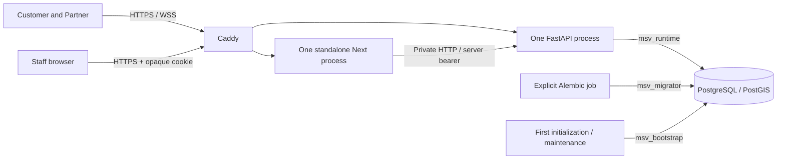

# Self-hosted production package

Implemented and locally tested. No VPS, domain, public certificate, SMTP provider
or signed phone build has been provisioned. Keep using the local development stack
while those owner-controlled resources remain unavailable.

## Connections and privileges



Only Caddy publishes TCP 80/443 and UDP 443. Database/API/admin have no host ports.
PostgreSQL uses an internal network; Caddy is absent from that network. API also
joins the outbound-capable edge network for SMTP and Expo. Forwarded client IPs
are trusted only from Caddy's fixed private address `172.30.60.2`. Caddy replaces
untrusted client forwarding headers by default. If subnet `172.30.60.0/24` overlaps
your server's networks, change its subnet, Caddy address and Uvicorn trust address
together. A CDN/additional proxy needs an explicit review of that trust chain.

| Role | Purpose | Authority |
|---|---|---|
| `msv_bootstrap` | Initialization and restricted operator maintenance | Cluster superuser; creates roles/extension; never supplied to API/admin |
| `msv_migrator` | Explicit Alembic process | Owns application schema/tables; cannot create databases or roles |
| `msv_runtime` | API, jobs and realtime listener | Application DML/sequences; no DDL, temporary tables, role creation, PostGIS metadata writes or Alembic revision writes |

Default privileges cover migrator-created tables. PostGIS remains bootstrap-owned;
runtime can read but cannot change `alembic_version`. FastAPI still enforces row
ownership, role and session checks. Database privileges do not replace them.

`bootstrap-roles.sh` runs on a new volume. Updating an environment password does
not change an existing cluster automatically. For intentional rotation: verify a
backup, stop dependent services, update the private file, execute that script as
the database operator inside the database container, then recreate API/migration
containers. Never delete a real volume to rotate passwords or repair startup.

## Configuration and startup

Copy `infrastructure/.env.production.example` to a private ignored file. Replace
all placeholders. Generate four independent random secrets; JWT requires at least
64 random characters. Restrict the file to its operator (Linux `chmod 600`, Windows
file Security settings). Docker administrators can inspect container environments
and are trusted operators. Never copy secrets into `EXPO_PUBLIC_*` variables.

Provide real domain/recovery origins, TLS SMTP settings and the owner-approved
GeoJSON pilot polygon. Test Chennai coordinates are synthetic, not a selected
launch boundary. Optional Expo project IDs/token may remain blank; delivery stays
unavailable. Keep the two app projects separate.

From PowerShell, substituting your actual private file:

```powershell
$taskProductionEnv = 'C:\private\mystreetvendor.production.env'
$taskProductionCompose = @('compose', '--env-file', $taskProductionEnv,
    '-f', 'infrastructure/compose.production.yaml')
docker @taskProductionCompose config --quiet
docker @taskProductionCompose build api admin
docker @taskProductionCompose up -d --wait db
docker @taskProductionCompose run --rm migrate
docker @taskProductionCompose up -d --wait api admin
docker @taskProductionCompose exec api python -m app.cli seed-categories
docker @taskProductionCompose exec api python -m app.cli create-admin --email 'YOUR_OPERATOR_EMAIL'
# Start public routing after DNS, firewall and real deployment inputs are ready.
docker @taskProductionCompose up -d caddy
```

The operator command prompts for its password. Alembic runs separately from API
startup. Set `MSV_IMAGE_TAG` to the reviewed Git commit for tagged releases; retain
previous images and compatible schema for rollback. Dropping schema/data is not
routine rollback. Review/pin base-image digests before public release.

Backend target `production` omits pytest/httpx2 and test scripts. Default target
`development` preserves local testing. Admin builds the monorepo, then copies
Next's standalone output and static assets into a non-root Node runtime. Both
apps run without root, with read-only filesystems and private temporary storage.
Build contexts exclude secrets/environments/backups/logs. Container logs rotate at
three 10 MB files per service.

Keep one API process and one admin process. Arrival candidates, WebSocket ownership
and staff sessions use bounded process memory. Admin restart requires a new login.
Adding workers/replicas would first require shared-state coordination.

## Debugging and repeatable local exercise

```powershell
docker @taskProductionCompose ps
docker @taskProductionCompose logs --tail 80 api
docker @taskProductionCompose exec api alembic -c alembic.ini current
docker @taskProductionCompose exec api python -c "import urllib.request; print(urllib.request.urlopen('http://127.0.0.1:8000/health',timeout=10).status)"
./infrastructure/scripts/Test-Production.ps1
# After a successful build:
./infrastructure/scripts/Test-Production.ps1 -SkipBuild
```

API JSON logs use request IDs, method, route template, status and duration. Raw
URLs/query strings, bodies and credentials are excluded. Caddy access logs are off;
its runtime filter removes request and response-header objects from proxy errors.
Do not enable debug/SQL/body logging on real users. Use `config --quiet`: plain
resolved Compose output contains secrets.

The exercise generates a random `msv_prod_check_*` project/database, synthetic HTTPS
origins and independent secrets; migrates through the real restricted migrator;
starts API/admin privately; checks runtime DML and six privilege denials; confirms
test dependencies are absent and real admin forwarding/cookie attributes; restarts
services and checks recovery. Cleanup removes only that generated project's
containers/networks/volume. It does not start public Caddy or contact SMTP/Expo.
Sending a Secure cookie manually over private HTTP checks its protocol attributes,
not browser TLS.

References: [PostgreSQL privileges](https://www.postgresql.org/docs/18/sql-alterdefaultprivileges.html),
[Next standalone deployment](https://nextjs.org/docs/app/api-reference/config/next-config-js/output),
[Caddy forwarding](https://caddyserver.com/docs/caddyfile/directives/reverse_proxy),
[Caddy log filtering](https://caddyserver.com/docs/caddyfile/directives/log).
