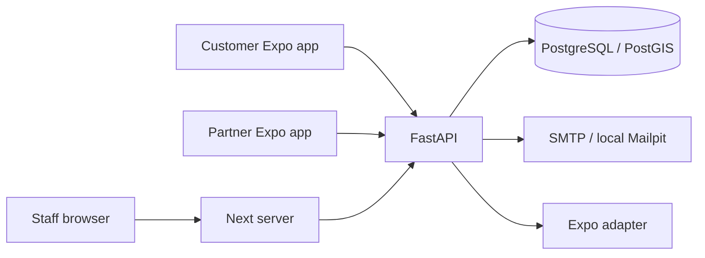
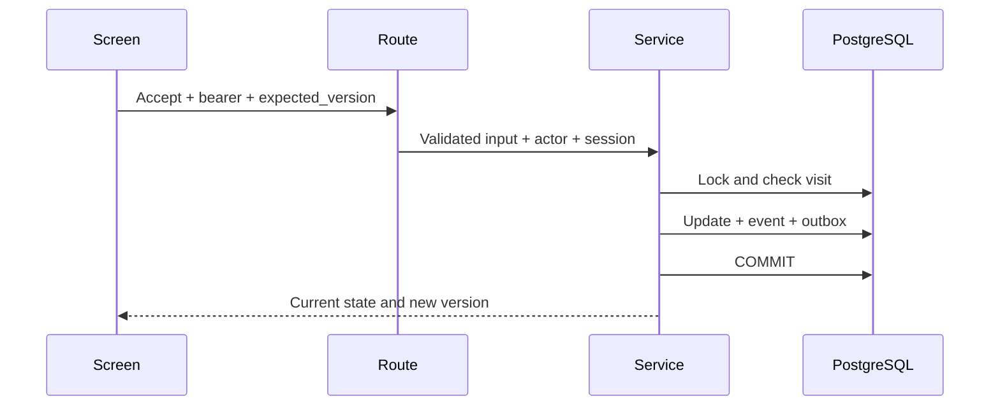

# MyStreetVendor project handbook

Edition: 4 November 2026. Read this beside the source code. It describes the integrated local MVP, following full-project approval on 2 November. The [foundation handbook](FOUNDATION_HANDBOOK.md) remains the earlier October edition.

Read chapters 1–4 to understand the system, then follow the feature paths in chapters 5–9. Chapters 10–12 help you run and debug it. [FILE_GUIDE.md](FILE_GUIDE.md) explains every maintained file; [LOCAL_VERIFICATION.md](LOCAL_VERIFICATION.md) records actual checks and limitations.

## 1. What you can do

A customer registers, chooses a public meeting point, finds verified available vendors and requests a visit. After acceptance, they can follow authorized fresh tracking, cancel, report an issue and read history. A home address is not required.

A partner uses a separate application. They edit their business, select bilingual categories and submit a short review note. Staff approval is required before going online. Sharing requires consent and a usable first GPS reading. The partner manages visits, opens external navigation and completes work after server-confirmed arrival.

Staff review businesses and reports, suspend/reinstate accounts or businesses, inspect visits with audit reasons and read operational counts. English/Tamil preferences, recovery links, account controls and unavailable states are implemented. Optional maps and notifications require suitable configuration and permissions. Completing a visit does not record inventory, money or a sale.

## 2. Applications and server



Production puts Caddy in front of both servers and exposes only its public ports. Development uses loopback ports. Mobile apps share transport, strict contracts and design tokens while owning screens and permissions independently.

FastAPI decides what a person may do. Hiding a button cannot replace backend authorization. PostgreSQL stores durable facts; PostGIS adds spatial types, indexes and metre-based calculations. One backend process contains feature modules, avoiding several networked services while learning and operating this MVP.

## 3. Follow an acceptance into PostgreSQL

The partner screen sends a visit ID, bearer token and last-read version. The route validates input, resolves the current actor and supplies a database session to the service. The service locks the visit, checks ownership/state/deadline/version, then changes status and appends its event and notification jobs.

One commit makes those related writes durable together. If an insert fails, rollback preserves the previous status/version. Provider network I/O happens after a separate claim transaction has released locks.



SQLAlchemy translates queries/model changes into bound SQL. Psycopg carries it over PostgreSQL connections. The engine owns a bounded pool; sessions borrow a connection when needed and return it after work. Connection, pool and statement timeouts limit waiting. Constructing an engine is lazy; a real health query establishes network connectivity.

Inside Docker the database is `db:5432`. Windows Python uses `127.0.0.1` and its published development port. `localhost` inside an API container means that API container. A phone never needs PostgreSQL access or its password.

## 4. Read the Python foundation

Start with `app/main.py`, `config.py`, `database.py` and `health.py`. `create_app` is a factory, allowing tests to construct independently configured applications. Lifespan owns the engine, realtime listener, jobs and shutdown cleanup.

`Settings` turns environment strings into validated values. `SecretStr` hides ordinary representations; it does not encrypt environment storage. `.env` is private, while `.env.example` is a placeholder template. Production rejects weak signing configuration, privileged runtime users, unsafe public origins, missing service-area configuration and unencrypted mail.

`get_db` yields a session from a context manager. FastAPI later resumes the generator to close it, including after failure. Closing unfinished work rolls it back. Routers define HTTP paths; schemas define accepted fields; services make business decisions; models describe tables. Comments explain lock order, commits, security and cleanup decisions.

## 5. Accounts and sessions

Registration fixes the role through its route. A vendor cannot submit `role=admin` or self-approve. Passwords are preserved rather than silently trimmed, checked for length/UTF-8 limits and hashed with Argon2id.

Login returns a ten-minute signed access token and random opaque refresh token. Only refresh hashes are stored. Rotation replaces the token; reuse revokes its family. An absolute 30-day deadline prevents endless login extension. Live account/family checks make logout and suspension affect existing access tokens.

Account locks precede session changes so logout cannot miss a concurrent refresh child. The shared client coordinates foreground refresh and uses a generation to stop an older response restoring credentials after sign-out. Native SecureStore holds each app's token pair. Mobile browser previews keep it in memory, so reload signs them out.

The staff browser receives an opaque cookie. Next holds API tokens in a bounded server registry, checks exact mutation Origin and forwards only allowlisted routes. Production cookies are HttpOnly, Secure and Strict. Restart clears staff sessions. Reset/verification tokens are hashed, single use and purpose-bound; app links use fragments cleared before submission. Mailpit captures local mail without proving real inbox delivery.

## 6. Location and privacy

`vendor_locations` stores one latest point, not a route. A fix has capture/receipt times and uncertainty. PostGIS constructors take longitude first; geography distances are metres. Inputs must be fresh, not excessively future-dated, accurate enough and newer than the stored fix.

Production needs an approved service-area polygon. Development uses a synthetic Chennai rectangle, not an approved pilot neighbourhood. Discovery returns a coarse grid region and kilometre band. Eligibility is filtered in SQL, results/radius are bounded, and cursor signatures bind to the user/query. Search-origin limits reduce repeated probing.

Exact vendor tracking is restricted to the visit's customer during accepted, approaching or arrived work, with fresh GPS and current eligibility. Offline/suspension/deletion erases the latest point in its transaction. A vanished phone cannot send offline, so maintenance removes abandoned points older than 90 seconds in bounded batches. It skips busy vendor locks and rechecks freshness to preserve a concurrent replacement.

Read filtering and physical erasure are different. Worker outages can delay deletion while freshness still blocks disclosure. Backups have separate retention. Phones can fabricate GPS; these checks cannot prove physical presence.

## 7. Visits and races

The main path is pending → accepted → approaching → arrived → completed. Vendors can decline pending work; participants can cancel active work; deadlines expire it. The server chooses allowed actions and terminal timestamps.

An idempotency key identifies one creation attempt. The same payload/key returns its existing visit; changed payload is a conflict. A partial unique index prevents duplicate active customer/vendor pairs. Versions protect later actions: if accept races cancel, an allowed serialized winner succeeds and the stale action refetches after a conflict.

Arrival requires two usable fixes at least five seconds apart, within 50 m, at most 30 seconds old and with at most 30 m uncertainty. Server timing and PostGIS distance are checked. Temporary debounce candidates contain times, not route histories.

Terminal points/labels/reasons are redacted after 24 hours and minimal visit history purged after 90 days. Deletion cancels active work and erases affected points. Expired refresh history and minimal audit records still need a retention/purge policy before collecting real personal data.

## 8. Realtime and notifications

WebSockets authenticate through a bounded first message without URL tokens. Limits bound subscriptions, queues and connections. The queue holds identifiers; sending resolves current state and rechecks authority. Reconnect/resume refetches REST rather than depending on missed frames.

PostgreSQL delivers ID-only hints after commit; these are not a durable replay log. Notification jobs are durable rows. A dispatcher claims a lease, releases the transaction, calls Expo and records guarded tickets/receipts. Device ownership includes user, app/project and session family; jobs cannot silently follow a transferred installation.

Generic alerts contain IDs. Taps must reauthorize through REST. A timeout can lose an acceptance response, so retries can duplicate an OS alert. Simulated-provider tests prove handling rules, not physical delivery.

## 9. The Expo projects

Each `app/` folder defines routes; screens live under `src/features/`. `_layout.tsx` assembles navigation/providers. TanStack Query caches server data; Zod validates responses. Recovery, language, account and notification modules connect platform services to the shared client.

Customer maps disclose providers and offer manual/list fallbacks. Web uses Leaflet; native maps require platform configuration. Partner navigation opens external maps after explicit choice.

Partner sharing has a controller, foreground provider and module-scope background task. Resume pauses synchronously before permission/account reads and restarts only with current authority and a fresh fix. Generation/nonce checks prevent old callbacks restarting sharing after offline/logout. Stopping sensors and confirming server offline state are separate steps, with visible degraded states on failure.

Headless callbacks do not rotate credentials. Background-only updates stop by the current access token's remaining expiry, at most 600 seconds. Foreground sessions can refresh. Shift-long unattended sharing needs a separate design and physical-device proof. Web previews cannot establish OS background scheduling or push delivery.

## 10. Run and inspect

Use [DEPLOYMENT.md](DEPLOYMENT.md) for PowerShell setup. Local ports are API 8000, PostgreSQL 5432, Mailpit web 8025/SMTP 1025, Customer 8081, Partner 8082 and Staff 3000. Physical phones need deliberate reachable API/firewall configuration; keep PostgreSQL private.

Apply migrations, seed categories and create your staff account interactively. Register each app account, submit the partner review, approve it in Staff and go online with usable GPS. Manual meeting points work without customer GPS.

```powershell
Invoke-RestMethod http://127.0.0.1:8000/health
./.venv/Scripts/python.exe backend/scripts/demo_workflow.py
./infrastructure/scripts/Test-Stack.ps1 -Browser -Production -NativeBundles
```

The demo uses maintained HTTP assertions and isolated real PostgreSQL without creating development demo accounts. Exports are JavaScript bundles, not signed installations. Rebuild/recreate the API after editing copied source; restarting an old image keeps old code.

## 11. Production and backups

Production uses private PostgreSQL, one API and one Node process behind Caddy. Bootstrap owns initialization; migrator owns schema changes; runtime has limited DML. Rehearsal verifies six actual privilege denials.

Caddy/Node have reserved proxy addresses excluded from dynamic allocation. Caddy overwrites client identity, Node validates it and forwards it for login. Only those private peers are trusted. Publishing Node directly would break that assumption.

Backups use custom-format archives and Docker file copy, never PowerShell text piping of binary bytes. Restore creates a new generated isolated database, queries schema/records and removes only its own target, including after failure. Binary does not mean encrypted. Restricted off-server encryption, scheduling, expiration and recovery ownership remain operator duties. Private HTTP rehearsal does not prove public TLS.

## 12. Debug independently

Name the failing layer and expected result first. Record a request ID, route, status and time without secrets. [DEBUGGING.md](DEBUGGING.md) gives complete commands.

| Symptom | First check |
|---|---|
| Docker fails | CLI PATH, Linux Server response, service state |
| Health 503 | Database status, safe log, PostGIS and migration revision |
| Edit has no effect | Rebuild/recreate the image |
| Login 401/429 | Current credentials/session or abuse window |
| Action 409 | Refetch version and allowed actions |
| Missing vendor | Review, consent, availability, freshness, area and category |
| No push | Config/permission, registration, outbox, ticket, receipt, device |

Try these with synthetic local data:

1. Explain lazy engine versus live health query by reading `database.py` and `health.py`.
2. Find the active-pair constraint, version comparison and commit in the visit model/migration/service.
3. Trace stale GPS through input validation, discovery, tracking and physical cleanup.
4. Run the demo and explain why fake-provider success does not prove phone delivery.
5. Find the six denied SQL operations and two simulated client IPs in the production probe.

Answers: connections are borrowed lazily; constraints and services guard different boundaries; hiding and erasing data have different deadlines; simulations prove only their tested scope; forwarding identity is trusted only across the configured private proxy chain. Use the [file guide](FILE_GUIDE.md) to locate the source and [verification record](LOCAL_VERIFICATION.md) to check your conclusions.
