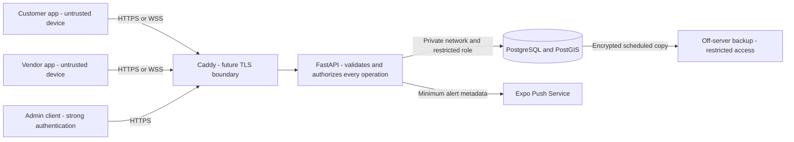
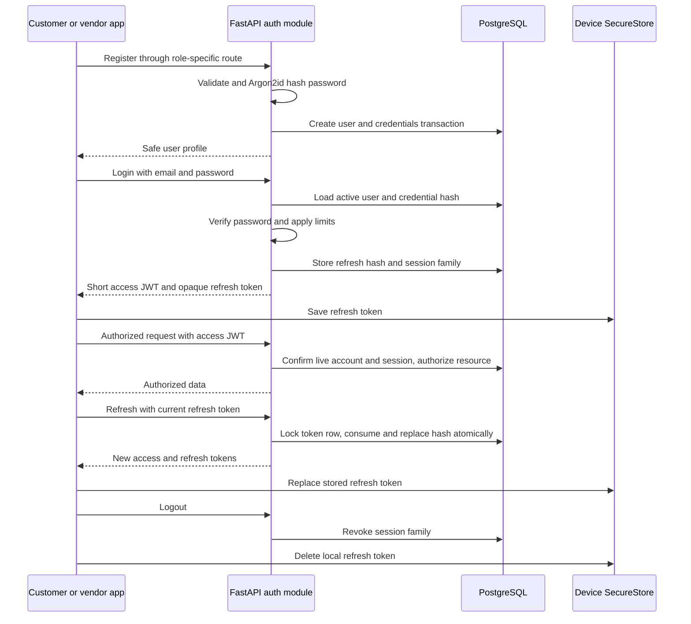

# Security and privacy design

Phase 0 design, 21 October 2026. Phase 1 is a local backend foundation. Authentication, role authorization, live location sharing, rate limiting and notification security below are **planned controls**, to be implemented and tested in their own phases before exposing real user data.

## Trust boundaries

Phone GPS, app state, timestamps and request IDs are inputs, not trusted facts. An authenticated vendor may still submit false GPS. The MVP validates freshness/accuracy and implausible jumps, but cannot prove physical presence from a phone report alone. Neither mobile app ever receives database credentials or connects directly to PostgreSQL.

## Threats and planned defenses

| Threat | Defense and verification |
|---|---|
| Password theft and credential stuffing | Argon2id hashes, generic login errors, per-account/IP limits, breached-password policy review, audit unusual failures. Test throttling without locking legitimate users indefinitely. |
| Stolen tokens and replay | Short access lifetime, hashed opaque refresh tokens, rotation with reuse detection, live session/account checks, TLS and secure device storage. Test expired/revoked/replayed tokens. |
| Customer reading another customer's visit | Actor-scoped queries and per-resource ownership checks. Test ID substitution on REST and sockets. |
| Vendor self-verification/admin escalation | Dedicated registration paths assign roles; only audited admins change verification. Reject privileged input fields. |
| Precise location stalking | Coarse discovery with distance bands, search limits, active-request-only precise tracking, immediate revocation on terminal/offline state. Test privacy on every transport. |
| Fake arrival or stale GPS | Server timestamps, monotonic latest-location update, freshness/accuracy limits and multi-observation arrival checks. Test simulated bad GPS. |
| Request races and duplicate alerts | Database transactions, expected versions, active-pair unique constraint, idempotency and transactional outbox. Test simultaneous actions and provider retry ambiguity. |
| SQL injection | SQLAlchemy bound parameters and validated query fields. No string-built SQL from client input. |
| Denial of service | Input/message limits, bounded pages/radii, database timeouts, socket connection/subscription/send limits, rate limiting. Measure costly spatial queries. |
| Secret/PII leaks through logs | Structured event codes, redaction, no password/token/coordinate/body dumps. Test error responses and logs with synthetic secrets. |
| Lost server/database | Persistent volumes, encrypted off-server backups and restore drills. A volume alone is not a backup. |

## Authentication design — Phase 2

Use server-owned email/password authentication initially. Customer and vendor registration are separate routes assigning fixed roles `CUSTOMER` and `VENDOR`. Administrative accounts require a controlled operator process; no public admin-registration route. Check the account's `ACTIVE`/`SUSPENDED`/`DELETED` state and session revocation on protected operations so suspension need not wait for access-token expiry.

Normalize email consistently before enforcing uniqueness. Preserve a display form separately if useful. Never silently trim or normalize passwords. Starting password policy: 15–128 characters, allow spaces and Unicode, no arbitrary composition rules; bound the encoded byte size to control hashing cost and document that bound in Phase 2. Reject known-compromised passwords before public launch using a privacy-preserving method. Registration must not imply email ownership; public production use requires real verification/recovery delivery and abuse controls.

Use a maintained Argon2id implementation with per-password random salts and encoded algorithm/cost metadata. Begin at least at the current OWASP minimum, benchmark on the target VPS and rehash when policy changes. Do not implement hashing primitives. OWASP currently lists Argon2id with at least 19 MiB memory, two iterations and one parallelism lane; confirm again when Phase 2 dependencies are selected. [Password storage guidance](https://cheatsheetseries.owasp.org/cheatsheets/Password_Storage_Cheat_Sheet.html)

JWT access tokens initially last 10 minutes and include `sub` (user UUID), `sid` (session family), `jti`, `iat`, `exp`, `iss`, and `aud`. Use a maintained library, a fixed allowlisted algorithm, a high-entropy signing secret/key from the environment, explicit issuer/audience validation and bounded clock skew. Do not choose the verification algorithm from attacker input. JWT payloads are readable: include no coordinates, password hashes, refresh secrets or private profile data. Keep signing keys separate from database credentials and support key rotation. FastAPI's [official security tutorial](https://fastapi.tiangolo.com/tutorial/security/oauth2-jwt/) provides framework integration patterns; this application's session/rotation rules still require implementation.

Refresh tokens are random high-entropy opaque secrets, initially at least 32 random bytes, with a 30-day absolute family expiry. Store only a cryptographic digest with family/user/expiry/consumed/revoked metadata. Fast hashing is suitable for these unpredictable tokens; password hashes need deliberately expensive Argon2id. Consume and replace a token under a database lock. Retain consumed hashes until family expiry to detect reuse. Reuse revokes the whole family and emits a security audit event. Apps serialize refresh attempts so simultaneous network requests do not race to consume the same token; a lost refresh response can require login again. Do not weaken replay detection through an undocumented grace period.

Logout revokes the current family; logout-all, password reset, deletion and suspension revoke every family. Protected operations consult live session state, including the original family's identifier across rotations. WebSockets must terminate or cease all private delivery when revocation/expiry occurs.

Rate limiting starts in Phase 2: combined source-IP and normalized-account limits, bounded escalating delay, generic failure messages and metrics. Keep an in-memory limiter in the single-instance MVP only if its restart/reset and multi-instance limitations are acceptable and documented. Shared limits become necessary before multiple API instances. Never use existence-specific login responses. Password recovery returns the same outward response for absent and present accounts and uses single-use expiring hashed reset tokens. Real SMS OTP requires a legitimate provider, expiry, attempt limits and verified ownership; no development bypass can be a production authentication path.

## Authorization and resource ownership

Roles are coarse permissions; ownership and current request state are additional checks. A vendor role does not grant access to every vendor profile's private data. An admin role does not justify logging precise location or unrestricted exports.

- Customer: own profile, request history and meeting points; public vendor profiles; precise tracking only for a qualifying accepted visit.
- Vendor: own profile, categories, availability and latest location; visits addressed to that vendor; customer meeting points only for those visits.
- Admin: explicit operational permissions for verification/suspension/support, with actor/reason/time audit. Stronger authentication is required before production admin access.
- Server: deadlines, arrival evaluation, verification side effects and notification recipients. The phone never declares authoritative arrival or session validity.

Use one authorization path per operation, shared by REST and socket delivery when the policy is the same. Recheck active request membership before every precise location event; a subscription created yesterday is not permanent permission. Queries should narrow by actor before loading private objects. Tests must attempt cross-account access, forged IDs and forbidden state changes.

## Location and personal data

Collect the minimum data required for a visit. The initial location table stores one latest point per vendor; there is no detailed movement-history feature. Sharing requires explicit vendor consent and an online state. Removing permission or going offline clears live exposure and prevents new discovery; clients show when tracking is active. The server must handle a phone that disappears without sending an offline update by enforcing freshness limits.

Discovery returns a coarse point/region and distance band, with search/radius limits. Do not return exact distances together with a rounded marker: repeated distance queries can reconstruct the underlying point. Do not treat rounding as a complete privacy guarantee. Prevent scraping using account limits, service-area checks and review of repeated changing-origin queries. Precise vendor location is available only to the owning vendor and a request's customer while state is `ACCEPTED`, `APPROACHING` or `ARRIVED`, sharing is on and the point is fresh. Terminal transitions revoke exposure on REST, sockets and local caches. Prior data already seen by another device cannot be remotely erased or made impossible to screenshot.

Meeting points can reveal a home address. Prefer a user-selected public meeting point, show who receives it, and restrict it to visit participants. Push alerts contain request identifiers and generic text, not precise points. Avoid coordinates in crash analytics, access logs and notification provider payloads. Device push tokens are private routing identifiers and must not appear in public profiles or normal logs.

Starting retention policy is a product proposal, not a legal conclusion: expire latest inactive location after 24 hours; remove request meeting points after 30 days unless a specific open safety case requires a documented hold; retain non-location request/audit metadata for 180 days; delete invalid/unregistered device tokens promptly; purge expired refresh families after the short security investigation window defined in DATABASE.md. Align the detailed table policy there before implementation. Verification documents require restricted private storage, a deletion deadline and access audit; use synthetic records in development. Do not accept document uploads before that workflow is implemented.

Account deletion immediately disables access, revokes tokens and stops sharing, then removes or irreversibly anonymizes personal fields according to the retention schedule. Referential integrity may require a pseudonymous tombstone for retained visit records. Backups age out under a documented schedule; the restore procedure must reapply outstanding deletion requests. Obtain privacy/legal review for actual deployment in India before collecting production identity/location data; these engineering choices do not certify compliance.

## Transport, devices and application clients

Production uses HTTPS/WSS through Caddy; keep PostgreSQL on a private Docker network with no public database listener. Device refresh tokens belong in Expo SecureStore, access tokens preferably in memory. Never ship server keys in an Expo environment variable or app bundle. SecureStore is device storage, not an account database or guaranteed recovery mechanism; uninstall/backup/biometric changes can affect availability. Handle a missing token by requesting login. [Expo SecureStore documentation](https://docs.expo.dev/versions/latest/sdk/securestore/)

The future admin browser uses a separately reviewed secure session/cookie flow, origin controls and CSRF protection where cookies authenticate writes. Do not copy the mobile token-storage pattern into browser local storage. Allowlist browser CORS origins if browser clients are introduced; CORS is not authorization and does not protect mobile/API clients. WebSocket authentication messages and authorization rules are specified in API.md; avoid tokens in query strings because URLs commonly enter logs.

## Phase 1 configuration and infrastructure limits

The local foundation has a public health endpoint and interactive API docs, without an authentication system. Keep the API and PostgreSQL published ports on loopback by default. Local database development credentials are not a production permission model. The eventual production application role must lack superuser, role-management and extension/schema-owner privileges. Use a separate migration role, install PostGIS under operator control and grant only needed schema/table/sequence privileges to the runtime account.

Keep `.env`, backups, database data and virtual environments out of Git. Track only `.env.example` with placeholders. Generate a unique local password; do not paste a live connection URL into issue reports or shell output. Container environment values are visible to operators with Docker access, so Docker access is privileged. Secrets are injected at runtime and never copied into the image. Future production secrets use restricted files or a suitable secret store, with rotation and access audit.

Use SQLAlchemy-bound statements, a bounded connection pool, connection/query timeouts and safe failure responses. `pool_pre_ping` detects stale pooled connections; it cannot rescue an in-flight transaction. Roll back failed work and retry only operations with explicit idempotency and bounded retry policy. Run migrations deliberately before deploying compatible API code; do not run schema creation on each request or use `create_all()` as a migration substitute.

Phase 1 must verify success/failure health responses, real PostgreSQL/PostGIS connectivity and migration state. It does not establish production readiness. Later release gates include dependency review, least-privilege testing, authentication/authorization tests, privacy tests, rate-limit abuse tests, restore drills, admin review and physical-device tracking/notification tests.

## Operational incident handling

First determine the affected boundary: phone, API, database, network or provider. Record a trace ID and safe error code, not the submitted secret. Revoke leaked sessions/keys, stop unnecessary location exposure, preserve minimal restricted audit evidence and rotate credentials. Restore into an isolated environment and validate migration/application compatibility before switching traffic. Document each resolved defect in DEBUGGING.md with its root cause, smallest fix and a meaningful regression test.
